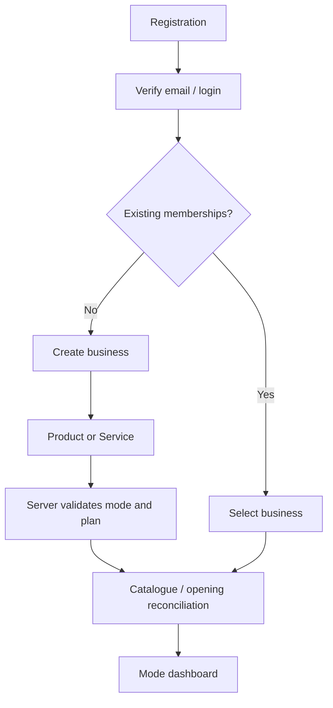
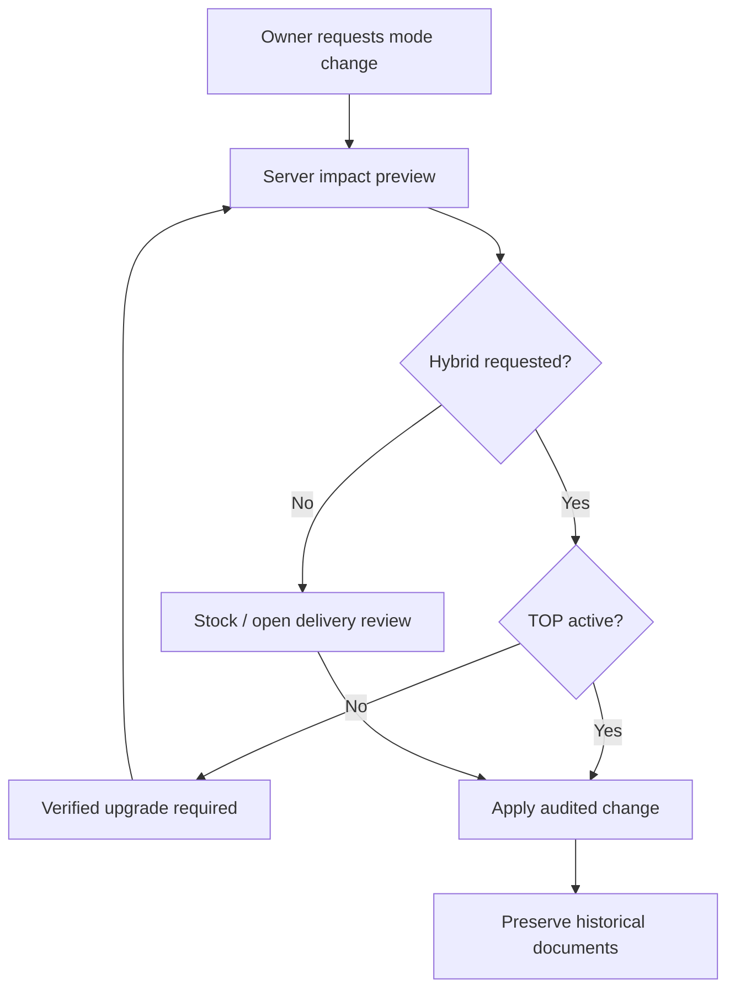
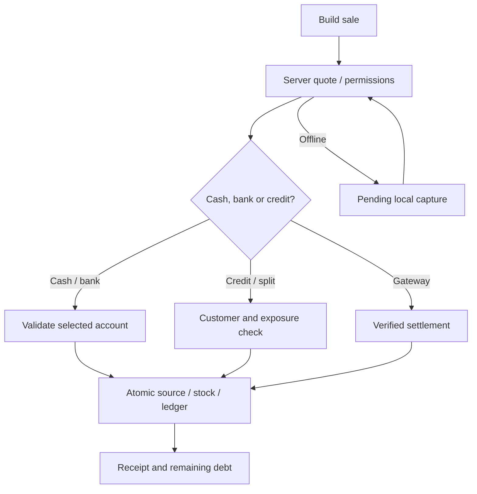
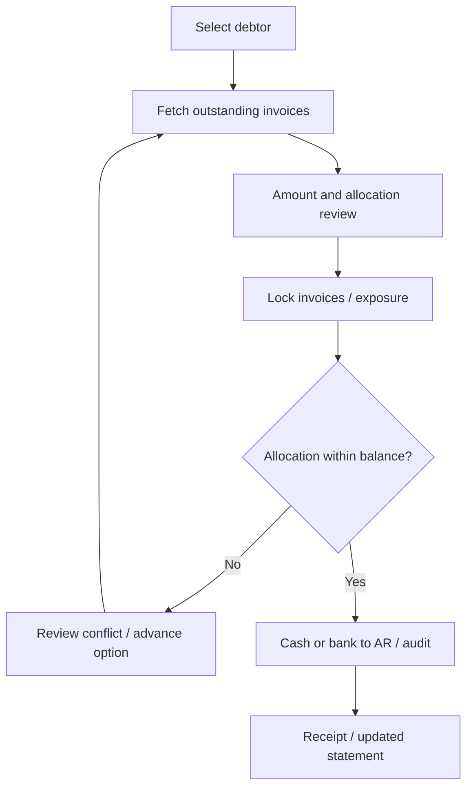
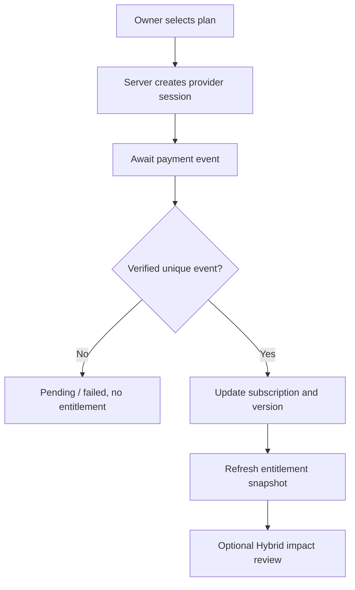
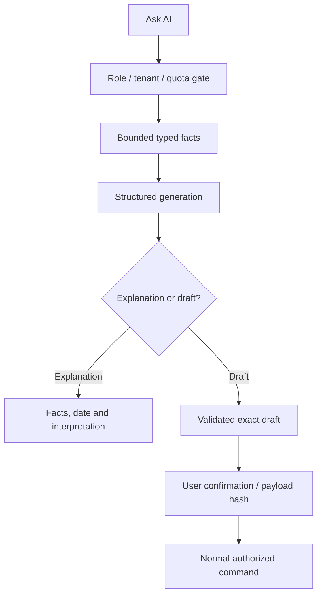
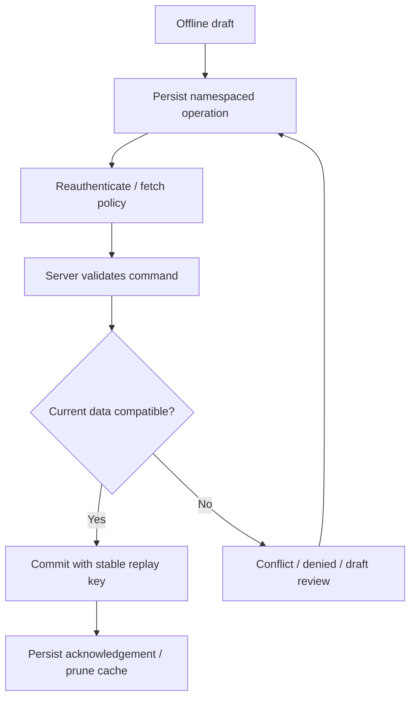

> Blueprint v1 · 11 October 2026 · Repository baseline `71ba8d08dc677f69e5bf0d18a3f00b6c6b22db65`. Source audit and proposed target design; no production activation is implied.

# Application flows and screen specification

## Shared screen contract

Routes without “proposed” already exist at the audited snapshot; route existence does not mean persistence is implemented. A screen ID is FLOW-{requirement}.{sequence}; group FLOW-{requirement} maps to the shared requirement register. Every screen follows UX-{requirement}, DB-{requirement} and AT-{requirement}, plus the screen-specific acceptance below. Existing prototype modules outside MVP stay hidden or explicitly unavailable until their backend is implemented; no demo amount or success toast in a production workflow.

Common layout: authenticated app shell with active business, mode and subscription status, navigation, main heading/action, filter/form/body, and contextual help. Fetch permissions/entitlements before privileged content; inaccessible routes return a reason and permitted navigation, not a client-only overlay. API paths below are relative to /api/v1/businesses/{business_id} unless Auth/public. “Proposed” APIs must be built; current Next Server Actions remain transitional adapters.

Common states: bounded skeleton with role=status during load; committed success only after server response; empty state contains relevant creation action only with permission; field validation retains input/focus; conflict offers review; dependency failure offers retry with original request key. On business switch, cancel requests and clear displayed data; late response from previous tenant cannot render. Offline read is dated last-known authorized data, and mutations become visibly pending drafts only when allowed. Permissions, billing, mode change, posting, gateway verification and AI provider calls require online checks. Keyboard order, visible focus, explicit labels/error associations, live status, 360px layout and text alternatives are required on every screen [technical R16].

## Complete primary flows

## Screen-to-domain contract catalogue

This catalogue defines fields, dependencies, actions and validations referenced by each route specification. Detail overlays and create/edit dialogs inherit the parent screen plus record version and tenant-owned ID checks. Any implemented route not in a listed MVP scope remains blocked until its assigned requirement is delivered.

| Domain | Fields and components | Actions / validation | API/data |
|---|---|---|---|
| Identity | Email/password, recovery link, session notices | Verify, login, reset; allowlisted callback, rate limit, no account enumeration | Supabase Auth, profiles; current verified identity |
| Business | Name, mode, sector/contact, timezone, optional logo | Create/select, preview/apply mode; no unchecked Hybrid, validated timezone | /businesses, /entitlements, /mode-changes; memberships |
| Billing | Plan feature comparison, limits/usage, status/expiry | Checkout/cancel; pending until signed event; no storage mutation as authority | /billing/checkout/status, /entitlements |
| Staff | Members, pending invitations, email, bundle, seat usage | Invite/edit/revoke/resend; grant ceiling, last owner, expiry | /invitations, /memberships |
| Parties | Search, name/contact, credit terms, history/statement | Create/archive; required name, normalized contacts, tenant ID | /customers, /suppliers, /statement |
| Catalogue | Product/service toggle, SKU, price, units, costs, active flag | Add/edit/archive, version conflict; product/service mode validation | /catalog, authoritative item version |
| Inventory | Stock, movement ledger, receiving form, reason/approval | Receive/adjust/transfer; no negative stock/direct overwrite, original cost | /purchases, /inventory/adjustments |
| Service | Service pricing, delivery list/status, attributable costs | Record delivery/cancel through corrective workflow; no stock deduction | /services/deliveries, /catalog |
| Sales | Searchable catalogue, cart, customer, quoted total, split payment, due date | Quote/confirm; stable request key, exposure/stock/account checks | /sales, /catalog, /customers, /entitlements |
| Invoices | Party, number/date/due date, snapshotted lines, totals/status | Save draft/issue/collect/credit; issued immutable, tenant unique number | /invoices, /receipts, /credit-notes |
| Receivables | Customer outstanding, invoice balances, due dates, allocations, follow-up | Credit eligibility, receipt, statement; no over-allocation/second revenue | /receivables/ageing, /receipts, /customers/{id}/statement |
| Expenses/AP | Account/category, supplier, amount/date, paid/unpaid, evidence | Draft/post/settle; valid mapping/open period, paid account selection | /expenses, /supplier-payments, /files |
| Accounting | Accounts, balanced draft lines, posting/source references, periods | Validate/post/reverse/close; debit=credit, immutable posted rows | /journals, /postings, /reports/summary |
| Reports | Date range, reconciled figures, drilldown, export/comparison | Fetch/export; bounded dates, source cash/AR/ledger reconciliation | /reports/{type}, /exports |
| AI | Suggested questions, facts/as-of citations, draft preview/confirm | Ask, accept draft; permission/quota/tools boundary | /ai/insights, /ai/drafts, /confirm |
| Offline | Connectivity, actual storage usage, pending/conflict list | Retry/review/export/discard with confirmation; never final offline posting | IndexedDB, /sync/operations, /operations/{key} |
| HR | Employee/attendance/payroll drafts, approval statuses | Save/review/approve where implemented; salary access and current policy | HR service transition → proposed /hr endpoints |
| Admin/settings | Preference fields, audit/retention/export status | Save versioned preferences; sensitive changes recent auth; no mock success | /settings, /audit, /exports, /deactivation |

## Route specifications

### FLOW-019.01 — Dashboard (`/`)

- **Purpose / requirement:** Analytics workflow; PRD-019, TECH-019, UX-019, DB-019, IMP-019.
- **Availability:** All dashboard; paid advanced; All with mode-specific metrics; Metric-specific reader. Existing route; audit implementation before activation.
- **Entry / navigation:** App navigation or authorized deep link; verified login and active membership. Return to domain list/dashboard; preserve filter context, never another business cache.
- **Layout / fields:** App shell where authenticated; heading and primary action; date range, permitted KPIs and supporting list filters; domain components in catalogue above.
- **Actions / validation:** Apply the analytics domain contract above; role-restricted actions absent from tab order and denied on direct API call. Use versioned save/create and source-linked details; no posted financial edit/delete action.
- **Data dependencies:** /reports/summary and bounded operational views; effective permission/entitlement snapshot; src/app/page.tsx.
- **Loading / success / empty / error:** Shared screen states; show committed server identity/status on success, clear stale tenant data on failure, and give a permission-appropriate empty action.
- **Offline / accessibility:** Shared offline and WCAG contract; final mutation online unless explicitly saved as pending draft. All fields have labels and inline validation; critical totals are text, not colour alone.
- **Acceptance:** Restricted margin/salary metrics cannot be retrieved through hidden widgets Test role denied deep link, empty tenant, API failure, narrow viewport and business switch as part of `AT-019`.

### FLOW-017.01 — Accounting (`/accounting`)

- **Purpose / requirement:** Accounting workflow; PRD-017, TECH-017, UX-017, DB-017, IMP-017.
- **Availability:** All engine; paid advanced forms; All; Accountant / explicitly authorized owner. Existing route; audit implementation before activation.
- **Entry / navigation:** App navigation or authorized deep link; verified login and active membership. Return to domain list/dashboard; preserve filter context, never another business cache.
- **Layout / fields:** App shell where authenticated; heading and primary action; accounts, posting date, balanced debit/credit rows, reason and source mapping; domain components in catalogue above.
- **Actions / validation:** Apply the accounting domain contract above; role-restricted actions absent from tab order and denied on direct API call. Use versioned save/create and source-linked details; no posted financial edit/delete action.
- **Data dependencies:** /journals, /postings, /reports/summary; effective permission/entitlement snapshot; src/app/accounting/page.tsx.
- **Loading / success / empty / error:** Shared screen states; show committed server identity/status on success, clear stale tenant data on failure, and give a permission-appropriate empty action.
- **Offline / accessibility:** Shared offline and WCAG contract; final mutation online unless explicitly saved as pending draft. All fields have labels and inline validation; critical totals are text, not colour alone.
- **Acceptance:** Closed period/unbalanced request fails without any ledger or audit residue Test role denied deep link, empty tenant, API failure, narrow viewport and business switch as part of `AT-017`.

### FLOW-018.01 — Cash Flow (`/accounting/cash-flow`)

- **Purpose / requirement:** Reports workflow; PRD-018, TECH-018, UX-018, DB-018, IMP-018.
- **Availability:** All core; paid detail/export; All; Report-specific reader/export permission. Existing route; audit implementation before activation.
- **Entry / navigation:** App navigation or authorized deep link; verified login and active membership. Return to domain list/dashboard; preserve filter context, never another business cache.
- **Layout / fields:** App shell where authenticated; heading and primary action; start/end dates, totals, comparison range, reconciliation difference and drilldown; domain components in catalogue above.
- **Actions / validation:** Apply the reports domain contract above; role-restricted actions absent from tab order and denied on direct API call. Reuse current CashFlowStatement UI/actions. Display indirect operating/investing/financing, opening/closing and explicit difference, policy/timezone, drilldown/comparison and permitted CSV/XLSX/PDF.
- **Data dependencies:** /reports/summary, /reports/cash-flow; additional report contracts proposed; effective permission/entitlement snapshot; src/app/accounting/cash-flow/page.tsx.
- **Loading / success / empty / error:** Shared screen states; show committed server identity/status on success, clear stale tenant data on failure, and give a permission-appropriate empty action.
- **Offline / accessibility:** Shared offline and WCAG contract; final mutation online unless explicitly saved as pending draft. All fields have labels and inline validation; critical totals are text, not colour alone.
- **Acceptance:** Failed report clears old figures and never fills a difference with demo data Test role denied deep link, empty tenant, API failure, narrow viewport and business switch as part of `AT-018`.

### FLOW-017.02 — Chart Of Accounts (`/accounting/chart-of-accounts`)

- **Purpose / requirement:** Accounting workflow; PRD-017, TECH-017, UX-017, DB-017, IMP-017.
- **Availability:** All engine; paid advanced forms; All; Accountant / explicitly authorized owner. Existing route; audit implementation before activation.
- **Entry / navigation:** App navigation or authorized deep link; verified login and active membership. Return to domain list/dashboard; preserve filter context, never another business cache.
- **Layout / fields:** App shell where authenticated; heading and primary action; accounts, posting date, balanced debit/credit rows, reason and source mapping; domain components in catalogue above.
- **Actions / validation:** Apply the accounting domain contract above; role-restricted actions absent from tab order and denied on direct API call. Use versioned save/create and source-linked details; no posted financial edit/delete action.
- **Data dependencies:** /journals, /postings, /reports/summary; effective permission/entitlement snapshot; src/app/accounting/chart-of-accounts/page.tsx.
- **Loading / success / empty / error:** Shared screen states; show committed server identity/status on success, clear stale tenant data on failure, and give a permission-appropriate empty action.
- **Offline / accessibility:** Shared offline and WCAG contract; final mutation online unless explicitly saved as pending draft. All fields have labels and inline validation; critical totals are text, not colour alone.
- **Acceptance:** Closed period/unbalanced request fails without any ledger or audit residue Test role denied deep link, empty tenant, API failure, narrow viewport and business switch as part of `AT-017`.

### FLOW-017.03 — Journal Entries (`/accounting/journal-entries`)

- **Purpose / requirement:** Accounting workflow; PRD-017, TECH-017, UX-017, DB-017, IMP-017.
- **Availability:** All engine; paid advanced forms; All; Accountant / explicitly authorized owner. Existing route; audit implementation before activation.
- **Entry / navigation:** App navigation or authorized deep link; verified login and active membership. Return to domain list/dashboard; preserve filter context, never another business cache.
- **Layout / fields:** App shell where authenticated; heading and primary action; accounts, posting date, balanced debit/credit rows, reason and source mapping; domain components in catalogue above.
- **Actions / validation:** Apply the accounting domain contract above; role-restricted actions absent from tab order and denied on direct API call. Use versioned save/create and source-linked details; no posted financial edit/delete action.
- **Data dependencies:** /journals, /postings, /reports/summary; effective permission/entitlement snapshot; src/app/accounting/journal-entries/page.tsx.
- **Loading / success / empty / error:** Shared screen states; show committed server identity/status on success, clear stale tenant data on failure, and give a permission-appropriate empty action.
- **Offline / accessibility:** Shared offline and WCAG contract; final mutation online unless explicitly saved as pending draft. All fields have labels and inline validation; critical totals are text, not colour alone.
- **Acceptance:** Closed period/unbalanced request fails without any ledger or audit residue Test role denied deep link, empty tenant, API failure, narrow viewport and business switch as part of `AT-017`.

### FLOW-017.04 — Policies (`/accounting/policies`)

- **Purpose / requirement:** Accounting workflow; PRD-017, TECH-017, UX-017, DB-017, IMP-017.
- **Availability:** All engine; paid advanced forms; All; Accountant / explicitly authorized owner. Existing route; audit implementation before activation.
- **Entry / navigation:** App navigation or authorized deep link; verified login and active membership. Return to domain list/dashboard; preserve filter context, never another business cache.
- **Layout / fields:** App shell where authenticated; heading and primary action; accounts, posting date, balanced debit/credit rows, reason and source mapping; domain components in catalogue above.
- **Actions / validation:** Apply the accounting domain contract above; role-restricted actions absent from tab order and denied on direct API call. Use versioned save/create and source-linked details; no posted financial edit/delete action.
- **Data dependencies:** /journals, /postings, /reports/summary; effective permission/entitlement snapshot; src/app/accounting/policies/page.tsx.
- **Loading / success / empty / error:** Shared screen states; show committed server identity/status on success, clear stale tenant data on failure, and give a permission-appropriate empty action.
- **Offline / accessibility:** Shared offline and WCAG contract; final mutation online unless explicitly saved as pending draft. All fields have labels and inline validation; critical totals are text, not colour alone.
- **Acceptance:** Closed period/unbalanced request fails without any ledger or audit residue Test role denied deep link, empty tenant, API failure, narrow viewport and business switch as part of `AT-017`.

### FLOW-017.05 — Trial Balance (`/accounting/trial-balance`)

- **Purpose / requirement:** Accounting workflow; PRD-017, TECH-017, UX-017, DB-017, IMP-017.
- **Availability:** All engine; paid advanced forms; All; Accountant / explicitly authorized owner. Existing route; audit implementation before activation.
- **Entry / navigation:** App navigation or authorized deep link; verified login and active membership. Return to domain list/dashboard; preserve filter context, never another business cache.
- **Layout / fields:** App shell where authenticated; heading and primary action; accounts, posting date, balanced debit/credit rows, reason and source mapping; domain components in catalogue above.
- **Actions / validation:** Apply the accounting domain contract above; role-restricted actions absent from tab order and denied on direct API call. Use versioned save/create and source-linked details; no posted financial edit/delete action.
- **Data dependencies:** /journals, /postings, /reports/summary; effective permission/entitlement snapshot; src/app/accounting/trial-balance/page.tsx.
- **Loading / success / empty / error:** Shared screen states; show committed server identity/status on success, clear stale tenant data on failure, and give a permission-appropriate empty action.
- **Offline / accessibility:** Shared offline and WCAG contract; final mutation online unless explicitly saved as pending draft. All fields have labels and inline validation; critical totals are text, not colour alone.
- **Acceptance:** Closed period/unbalanced request fails without any ledger or audit residue Test role denied deep link, empty tenant, API failure, narrow viewport and business switch as part of `AT-017`.

### FLOW-026.01 — Staging (`/admin/staging`)

- **Purpose / requirement:** Admin workflow; PRD-026, TECH-026, UX-026, DB-026, IMP-026.
- **Availability:** All permitted settings; All; Owner/admin or own-profile editor. Existing route; audit implementation before activation.
- **Entry / navigation:** App navigation or authorized deep link; verified login and active membership. Return to domain list/dashboard; preserve filter context, never another business cache.
- **Layout / fields:** App shell where authenticated; heading and primary action; versioned preference, audit filters, export/deactivate status; domain components in catalogue above.
- **Actions / validation:** Apply the admin domain contract above; role-restricted actions absent from tab order and denied on direct API call. Only time-bound platform support with explicit tenant authorization, no ordinary owner access to global data. Current route needs separate deployed access verification.
- **Data dependencies:** /settings, /audit and /exports proposed; effective permission/entitlement snapshot; src/app/admin/staging/page.tsx.
- **Loading / success / empty / error:** Shared screen states; show committed server identity/status on success, clear stale tenant data on failure, and give a permission-appropriate empty action.
- **Offline / accessibility:** Shared offline and WCAG contract; final mutation online unless explicitly saved as pending draft. All fields have labels and inline validation; critical totals are text, not colour alone.
- **Acceptance:** Sensitive changes record actor and require current authorization; no false saved state Test role denied deep link, empty tenant, API failure, narrow viewport and business switch as part of `AT-026`.

### FLOW-019.02 — Analytics (`/analytics`)

- **Purpose / requirement:** Analytics workflow; PRD-019, TECH-019, UX-019, DB-019, IMP-019.
- **Availability:** All dashboard; paid advanced; All with mode-specific metrics; Metric-specific reader. Existing route; audit implementation before activation.
- **Entry / navigation:** App navigation or authorized deep link; verified login and active membership. Return to domain list/dashboard; preserve filter context, never another business cache.
- **Layout / fields:** App shell where authenticated; heading and primary action; date range, permitted KPIs and supporting list filters; domain components in catalogue above.
- **Actions / validation:** Apply the analytics domain contract above; role-restricted actions absent from tab order and denied on direct API call. Use versioned save/create and source-linked details; no posted financial edit/delete action.
- **Data dependencies:** /reports/summary and bounded operational views; effective permission/entitlement snapshot; src/app/analytics/page.tsx.
- **Loading / success / empty / error:** Shared screen states; show committed server identity/status on success, clear stale tenant data on failure, and give a permission-appropriate empty action.
- **Offline / accessibility:** Shared offline and WCAG contract; final mutation online unless explicitly saved as pending draft. All fields have labels and inline validation; critical totals are text, not colour alone.
- **Acceptance:** Restricted margin/salary metrics cannot be retrieved through hidden widgets Test role denied deep link, empty tenant, API failure, narrow viewport and business switch as part of `AT-019`.

### FLOW-014.01 — Aging Reports (`/analytics/aging-reports`)

- **Purpose / requirement:** Receivables workflow; PRD-014, TECH-014, UX-014, DB-014, IMP-014.
- **Availability:** All basic; paid collection automation; All; Debt reader; receipt/credit/limit permission for edits. Existing route; audit implementation before activation.
- **Entry / navigation:** App navigation or authorized deep link; verified login and active membership. Return to domain list/dashboard; preserve filter context, never another business cache.
- **Layout / fields:** App shell where authenticated; heading and primary action; as-of date, overdue buckets, customer/invoice balances and allocation history; domain components in catalogue above.
- **Actions / validation:** Apply the receivables domain contract above; role-restricted actions absent from tab order and denied on direct API call. Use versioned save/create and source-linked details; no posted financial edit/delete action.
- **Data dependencies:** /receivables/ageing and /customers/{id}/statement; effective permission/entitlement snapshot; src/app/analytics/aging-reports/page.tsx.
- **Loading / success / empty / error:** Shared screen states; show committed server identity/status on success, clear stale tenant data on failure, and give a permission-appropriate empty action.
- **Offline / accessibility:** Shared offline and WCAG contract; final mutation online unless explicitly saved as pending draft. All fields have labels and inline validation; critical totals are text, not colour alone.
- **Acceptance:** Bucket totals reconcile to AR and include a separate no-due-date row Test role denied deep link, empty tenant, API failure, narrow viewport and business switch as part of `AT-014`.

### FLOW-019.03 — Budget Vs Actual (`/analytics/budget-vs-actual`)

- **Purpose / requirement:** Analytics workflow; PRD-019, TECH-019, UX-019, DB-019, IMP-019.
- **Availability:** All dashboard; paid advanced; All with mode-specific metrics; Metric-specific reader. Existing route; audit implementation before activation.
- **Entry / navigation:** App navigation or authorized deep link; verified login and active membership. Return to domain list/dashboard; preserve filter context, never another business cache.
- **Layout / fields:** App shell where authenticated; heading and primary action; date range, permitted KPIs and supporting list filters; domain components in catalogue above.
- **Actions / validation:** Apply the analytics domain contract above; role-restricted actions absent from tab order and denied on direct API call. Use versioned save/create and source-linked details; no posted financial edit/delete action.
- **Data dependencies:** /reports/summary and bounded operational views; effective permission/entitlement snapshot; src/app/analytics/budget-vs-actual/page.tsx.
- **Loading / success / empty / error:** Shared screen states; show committed server identity/status on success, clear stale tenant data on failure, and give a permission-appropriate empty action.
- **Offline / accessibility:** Shared offline and WCAG contract; final mutation online unless explicitly saved as pending draft. All fields have labels and inline validation; critical totals are text, not colour alone.
- **Acceptance:** Restricted margin/salary metrics cannot be retrieved through hidden widgets Test role denied deep link, empty tenant, API failure, narrow viewport and business switch as part of `AT-019`.

### FLOW-019.04 — Kpi (`/analytics/kpi`)

- **Purpose / requirement:** Analytics workflow; PRD-019, TECH-019, UX-019, DB-019, IMP-019.
- **Availability:** All dashboard; paid advanced; All with mode-specific metrics; Metric-specific reader. Existing route; audit implementation before activation.
- **Entry / navigation:** App navigation or authorized deep link; verified login and active membership. Return to domain list/dashboard; preserve filter context, never another business cache.
- **Layout / fields:** App shell where authenticated; heading and primary action; date range, permitted KPIs and supporting list filters; domain components in catalogue above.
- **Actions / validation:** Apply the analytics domain contract above; role-restricted actions absent from tab order and denied on direct API call. Use versioned save/create and source-linked details; no posted financial edit/delete action.
- **Data dependencies:** /reports/summary and bounded operational views; effective permission/entitlement snapshot; src/app/analytics/kpi/page.tsx.
- **Loading / success / empty / error:** Shared screen states; show committed server identity/status on success, clear stale tenant data on failure, and give a permission-appropriate empty action.
- **Offline / accessibility:** Shared offline and WCAG contract; final mutation online unless explicitly saved as pending draft. All fields have labels and inline validation; critical totals are text, not colour alone.
- **Acceptance:** Restricted margin/salary metrics cannot be retrieved through hidden widgets Test role denied deep link, empty tenant, API failure, narrow viewport and business switch as part of `AT-019`.

### FLOW-019.05 — Planning (`/analytics/planning`)

- **Purpose / requirement:** Analytics workflow; PRD-019, TECH-019, UX-019, DB-019, IMP-019.
- **Availability:** All dashboard; paid advanced; All with mode-specific metrics; Metric-specific reader. Existing route; audit implementation before activation.
- **Entry / navigation:** App navigation or authorized deep link; verified login and active membership. Return to domain list/dashboard; preserve filter context, never another business cache.
- **Layout / fields:** App shell where authenticated; heading and primary action; date range, permitted KPIs and supporting list filters; domain components in catalogue above.
- **Actions / validation:** Apply the analytics domain contract above; role-restricted actions absent from tab order and denied on direct API call. Use versioned save/create and source-linked details; no posted financial edit/delete action.
- **Data dependencies:** /reports/summary and bounded operational views; effective permission/entitlement snapshot; src/app/analytics/planning/page.tsx.
- **Loading / success / empty / error:** Shared screen states; show committed server identity/status on success, clear stale tenant data on failure, and give a permission-appropriate empty action.
- **Offline / accessibility:** Shared offline and WCAG contract; final mutation online unless explicitly saved as pending draft. All fields have labels and inline validation; critical totals are text, not colour alone.
- **Acceptance:** Restricted margin/salary metrics cannot be retrieved through hidden widgets Test role denied deep link, empty tenant, API failure, narrow viewport and business switch as part of `AT-019`.

### FLOW-019.06 — Reconciliation (`/analytics/reconciliation`)

- **Purpose / requirement:** Analytics workflow; PRD-019, TECH-019, UX-019, DB-019, IMP-019.
- **Availability:** All dashboard; paid advanced; All with mode-specific metrics; Metric-specific reader. Existing route; audit implementation before activation.
- **Entry / navigation:** App navigation or authorized deep link; verified login and active membership. Return to domain list/dashboard; preserve filter context, never another business cache.
- **Layout / fields:** App shell where authenticated; heading and primary action; date range, permitted KPIs and supporting list filters; domain components in catalogue above.
- **Actions / validation:** Apply the analytics domain contract above; role-restricted actions absent from tab order and denied on direct API call. Use versioned save/create and source-linked details; no posted financial edit/delete action.
- **Data dependencies:** /reports/summary and bounded operational views; effective permission/entitlement snapshot; src/app/analytics/reconciliation/page.tsx.
- **Loading / success / empty / error:** Shared screen states; show committed server identity/status on success, clear stale tenant data on failure, and give a permission-appropriate empty action.
- **Offline / accessibility:** Shared offline and WCAG contract; final mutation online unless explicitly saved as pending draft. All fields have labels and inline validation; critical totals are text, not colour alone.
- **Acceptance:** Restricted margin/salary metrics cannot be retrieved through hidden widgets Test role denied deep link, empty tenant, API failure, narrow viewport and business switch as part of `AT-019`.

### FLOW-019.07 — Top Selling (`/analytics/top-selling`)

- **Purpose / requirement:** Analytics workflow; PRD-019, TECH-019, UX-019, DB-019, IMP-019.
- **Availability:** All dashboard; paid advanced; All with mode-specific metrics; Metric-specific reader. Existing route; audit implementation before activation.
- **Entry / navigation:** App navigation or authorized deep link; verified login and active membership. Return to domain list/dashboard; preserve filter context, never another business cache.
- **Layout / fields:** App shell where authenticated; heading and primary action; date range, permitted KPIs and supporting list filters; domain components in catalogue above.
- **Actions / validation:** Apply the analytics domain contract above; role-restricted actions absent from tab order and denied on direct API call. Use versioned save/create and source-linked details; no posted financial edit/delete action.
- **Data dependencies:** /reports/summary and bounded operational views; effective permission/entitlement snapshot; src/app/analytics/top-selling/page.tsx.
- **Loading / success / empty / error:** Shared screen states; show committed server identity/status on success, clear stale tenant data on failure, and give a permission-appropriate empty action.
- **Offline / accessibility:** Shared offline and WCAG contract; final mutation online unless explicitly saved as pending draft. All fields have labels and inline validation; critical totals are text, not colour alone.
- **Acceptance:** Restricted margin/salary metrics cannot be retrieved through hidden widgets Test role denied deep link, empty tenant, API failure, narrow viewport and business switch as part of `AT-019`.

### FLOW-008.01 — Appointments (`/appointments`)

- **Purpose / requirement:** Service workflow; PRD-008, TECH-008, UX-008, DB-008, IMP-008.
- **Availability:** All; Service, Hybrid; Service manager / assigned worker. Existing route; audit implementation before activation.
- **Entry / navigation:** App navigation or authorized deep link; verified login and active membership. Return to domain list/dashboard; preserve filter context, never another business cache.
- **Layout / fields:** App shell where authenticated; heading and primary action; service line, delivery date/status, direct cost and version; domain components in catalogue above.
- **Actions / validation:** Apply the service domain contract above; role-restricted actions absent from tab order and denied on direct API call. Use versioned save/create and source-linked details; no posted financial edit/delete action.
- **Data dependencies:** /services/deliveries and /catalog; effective permission/entitlement snapshot; src/app/appointments/page.tsx.
- **Loading / success / empty / error:** Shared screen states; show committed server identity/status on success, clear stale tenant data on failure, and give a permission-appropriate empty action.
- **Offline / accessibility:** Shared offline and WCAG contract; final mutation online unless explicitly saved as pending draft. All fields have labels and inline validation; critical totals are text, not colour alone.
- **Acceptance:** Completing a service never decrements product stock Test role denied deep link, empty tenant, API failure, narrow viewport and business switch as part of `AT-008`.

### FLOW-024.01 — Apps (`/apps`)

- **Purpose / requirement:** Integrations workflow; PRD-024, TECH-024, UX-024, DB-024, IMP-024.
- **Availability:** Paid approved integrations after P2; All; Integration/admin permission. Existing route; audit implementation before activation.
- **Entry / navigation:** App navigation or authorized deep link; verified login and active membership. Return to domain list/dashboard; preserve filter context, never another business cache.
- **Layout / fields:** App shell where authenticated; heading and primary action; provider status, scopes, consent and last verified event; domain components in catalogue above.
- **Actions / validation:** Apply the integrations domain contract above; role-restricted actions absent from tab order and denied on direct API call. Post-MVP PRD-024 integration catalogue. Disabled cards for unavailable providers; connect/disconnect requires scoped credentials and audited authorization.
- **Data dependencies:** /integrations, /exports proposed; effective permission/entitlement snapshot; src/app/apps/page.tsx.
- **Loading / success / empty / error:** Shared screen states; show committed server identity/status on success, clear stale tenant data on failure, and give a permission-appropriate empty action.
- **Offline / accessibility:** Shared offline and WCAG contract; final mutation online unless explicitly saved as pending draft. All fields have labels and inline validation; critical totals are text, not colour alone.
- **Acceptance:** Unavailable provider cards cannot claim connected/payment success Test role denied deep link, empty tenant, API failure, narrow viewport and business switch as part of `AT-024`.

### FLOW-007.01 — Catalog (`/catalog`)

- **Purpose / requirement:** Catalogue workflow; PRD-007, TECH-007, UX-007, DB-007, IMP-007.
- **Availability:** All; Product, Hybrid; Service via PRD-008; Catalogue reader / appropriate editor. Existing route; audit implementation before activation.
- **Entry / navigation:** App navigation or authorized deep link; verified login and active membership. Return to domain list/dashboard; preserve filter context, never another business cache.
- **Layout / fields:** App shell where authenticated; heading and primary action; item_type, SKU/product unit or service duration, name, decimal price and version; domain components in catalogue above.
- **Actions / validation:** Apply the catalogue domain contract above; role-restricted actions absent from tab order and denied on direct API call. Use versioned save/create and source-linked details; no posted financial edit/delete action.
- **Data dependencies:** /catalog; effective permission/entitlement snapshot; src/app/catalog/page.tsx.
- **Loading / success / empty / error:** Shared screen states; show committed server identity/status on success, clear stale tenant data on failure, and give a permission-appropriate empty action.
- **Offline / accessibility:** Shared offline and WCAG contract; final mutation online unless explicitly saved as pending draft. All fields have labels and inline validation; critical totals are text, not colour alone.
- **Acceptance:** Historical invoices retain their stored description/price after catalogue edits Test role denied deep link, empty tenant, API failure, narrow viewport and business switch as part of `AT-007`.

### FLOW-026.02 — Community (`/community`)

- **Purpose / requirement:** Admin workflow; PRD-026, TECH-026, UX-026, DB-026, IMP-026.
- **Availability:** All permitted settings; All; Owner/admin or own-profile editor. Existing route; audit implementation before activation.
- **Entry / navigation:** App navigation or authorized deep link; verified login and active membership. Return to domain list/dashboard; preserve filter context, never another business cache.
- **Layout / fields:** App shell where authenticated; heading and primary action; versioned preference, audit filters, export/deactivate status; domain components in catalogue above.
- **Actions / validation:** Apply the admin domain contract above; role-restricted actions absent from tab order and denied on direct API call. Defer beyond MVP under PRD-026 support navigation; no sample posts/members represented as actual community.
- **Data dependencies:** /settings, /audit and /exports proposed; effective permission/entitlement snapshot; src/app/community/page.tsx.
- **Loading / success / empty / error:** Shared screen states; show committed server identity/status on success, clear stale tenant data on failure, and give a permission-appropriate empty action.
- **Offline / accessibility:** Shared offline and WCAG contract; final mutation online unless explicitly saved as pending draft. All fields have labels and inline validation; critical totals are text, not colour alone.
- **Acceptance:** Sensitive changes record actor and require current authorization; no false saved state Test role denied deep link, empty tenant, API failure, narrow viewport and business switch as part of `AT-026`.

### FLOW-014.02 — Credit (`/credit`)

- **Purpose / requirement:** Receivables workflow; PRD-014, TECH-014, UX-014, DB-014, IMP-014.
- **Availability:** All basic; paid collection automation; All; Debt reader; receipt/credit/limit permission for edits. Existing route; audit implementation before activation.
- **Entry / navigation:** App navigation or authorized deep link; verified login and active membership. Return to domain list/dashboard; preserve filter context, never another business cache.
- **Layout / fields:** App shell where authenticated; heading and primary action; as-of date, overdue buckets, customer/invoice balances and allocation history; domain components in catalogue above.
- **Actions / validation:** Apply the receivables domain contract above; role-restricted actions absent from tab order and denied on direct API call. Existing lending-offer prototype is outside customer-credit scope. Hide lending offers/applications; redirect to /receivables when delivered. Do not describe sample lenders as real credit access.
- **Data dependencies:** /receivables/ageing and /customers/{id}/statement; effective permission/entitlement snapshot; src/app/credit/page.tsx.
- **Loading / success / empty / error:** Shared screen states; show committed server identity/status on success, clear stale tenant data on failure, and give a permission-appropriate empty action.
- **Offline / accessibility:** Shared offline and WCAG contract; final mutation online unless explicitly saved as pending draft. All fields have labels and inline validation; critical totals are text, not colour alone.
- **Acceptance:** Bucket totals reconcile to AR and include a separate no-due-date row Test role denied deep link, empty tenant, API failure, narrow viewport and business switch as part of `AT-014`.

### FLOW-006.01 — Customers (`/customers`)

- **Purpose / requirement:** Parties workflow; PRD-006, TECH-006, UX-006, DB-006, IMP-006.
- **Availability:** All; All; Directory reader; write permission for edits. Existing route; audit implementation before activation.
- **Entry / navigation:** App navigation or authorized deep link; verified login and active membership. Return to domain list/dashboard; preserve filter context, never another business cache.
- **Layout / fields:** App shell where authenticated; heading and primary action; name/contact, active flag, optional customer terms and tenant history; domain components in catalogue above.
- **Actions / validation:** Apply the parties domain contract above; role-restricted actions absent from tab order and denied on direct API call. Use versioned save/create and source-linked details; no posted financial edit/delete action.
- **Data dependencies:** /customers or /suppliers; effective permission/entitlement snapshot; src/app/customers/page.tsx.
- **Loading / success / empty / error:** Shared screen states; show committed server identity/status on success, clear stale tenant data on failure, and give a permission-appropriate empty action.
- **Offline / accessibility:** Shared offline and WCAG contract; final mutation online unless explicitly saved as pending draft. All fields have labels and inline validation; critical totals are text, not colour alone.
- **Acceptance:** A foreign-party deep link returns unavailable without exposing identity Test role denied deep link, empty tenant, API failure, narrow viewport and business switch as part of `AT-006`.

### FLOW-001.01 — Forgot Password (`/forgot-password`)

- **Purpose / requirement:** Identity workflow; PRD-001, TECH-001, UX-001, DB-001, IMP-001.
- **Availability:** All; All; Public entry; verified identity for account changes. Existing route; audit implementation before activation.
- **Entry / navigation:** Public entry or Auth recovery/verification link; return only to allowlisted route. Return to domain list/dashboard; preserve filter context, never another business cache.
- **Layout / fields:** App shell where authenticated; heading and primary action; email, password and recovery challenge; domain components in catalogue above.
- **Actions / validation:** Apply the identity domain contract above; role-restricted actions absent from tab order and denied on direct API call. Use versioned save/create and source-linked details; no posted financial edit/delete action.
- **Data dependencies:** Supabase Auth; effective permission/entitlement snapshot; src/app/forgot-password/page.tsx.
- **Loading / success / empty / error:** Shared screen states; show committed server identity/status on success, clear stale tenant data on failure, and give a permission-appropriate empty action.
- **Offline / accessibility:** Shared offline and WCAG contract; final mutation online unless explicitly saved as pending draft. All fields have labels and inline validation; critical totals are text, not colour alone.
- **Acceptance:** Sign in/verify/recover routes establish a verified identity, never trust browser session claims Test role denied deep link, empty tenant, API failure, narrow viewport and business switch as part of `AT-001`.

### FLOW-025.01 — Hr (`/hr`)

- **Purpose / requirement:** HR workflow; PRD-025, TECH-025, UX-025, DB-025, IMP-025.
- **Availability:** Paid after P2; All; HR-specific reader/editor; finance approval separately. Existing route; audit implementation before activation.
- **Entry / navigation:** App navigation or authorized deep link; verified login and active membership. Return to domain list/dashboard; preserve filter context, never another business cache.
- **Layout / fields:** App shell where authenticated; heading and primary action; employee, attendance, payroll period, policy version, approvals; domain components in catalogue above.
- **Actions / validation:** Apply the hr domain contract above; role-restricted actions absent from tab order and denied on direct API call. Use versioned save/create and source-linked details; no posted financial edit/delete action.
- **Data dependencies:** Existing HR actions/services; target /hr scoped endpoints; effective permission/entitlement snapshot; src/app/hr/page.tsx.
- **Loading / success / empty / error:** Shared screen states; show committed server identity/status on success, clear stale tenant data on failure, and give a permission-appropriate empty action.
- **Offline / accessibility:** Shared offline and WCAG contract; final mutation online unless explicitly saved as pending draft. All fields have labels and inline validation; critical totals are text, not colour alone.
- **Acceptance:** Cashier requests to salary data fail at API/DB projection regardless of navigation Test role denied deep link, empty tenant, API failure, narrow viewport and business switch as part of `AT-025`.

### FLOW-025.02 — Attendance (`/hr/attendance`)

- **Purpose / requirement:** HR workflow; PRD-025, TECH-025, UX-025, DB-025, IMP-025.
- **Availability:** Paid after P2; All; HR-specific reader/editor; finance approval separately. Existing route; audit implementation before activation.
- **Entry / navigation:** App navigation or authorized deep link; verified login and active membership. Return to domain list/dashboard; preserve filter context, never another business cache.
- **Layout / fields:** App shell where authenticated; heading and primary action; employee, attendance, payroll period, policy version, approvals; domain components in catalogue above.
- **Actions / validation:** Apply the hr domain contract above; role-restricted actions absent from tab order and denied on direct API call. Use versioned save/create and source-linked details; no posted financial edit/delete action.
- **Data dependencies:** Existing HR actions/services; target /hr scoped endpoints; effective permission/entitlement snapshot; src/app/hr/attendance/page.tsx.
- **Loading / success / empty / error:** Shared screen states; show committed server identity/status on success, clear stale tenant data on failure, and give a permission-appropriate empty action.
- **Offline / accessibility:** Shared offline and WCAG contract; final mutation online unless explicitly saved as pending draft. All fields have labels and inline validation; critical totals are text, not colour alone.
- **Acceptance:** Cashier requests to salary data fail at API/DB projection regardless of navigation Test role denied deep link, empty tenant, API failure, narrow viewport and business switch as part of `AT-025`.

### FLOW-025.03 — Employees (`/hr/employees`)

- **Purpose / requirement:** HR workflow; PRD-025, TECH-025, UX-025, DB-025, IMP-025.
- **Availability:** Paid after P2; All; HR-specific reader/editor; finance approval separately. Existing route; audit implementation before activation.
- **Entry / navigation:** App navigation or authorized deep link; verified login and active membership. Return to domain list/dashboard; preserve filter context, never another business cache.
- **Layout / fields:** App shell where authenticated; heading and primary action; employee, attendance, payroll period, policy version, approvals; domain components in catalogue above.
- **Actions / validation:** Apply the hr domain contract above; role-restricted actions absent from tab order and denied on direct API call. Use versioned save/create and source-linked details; no posted financial edit/delete action.
- **Data dependencies:** Existing HR actions/services; target /hr scoped endpoints; effective permission/entitlement snapshot; src/app/hr/employees/page.tsx.
- **Loading / success / empty / error:** Shared screen states; show committed server identity/status on success, clear stale tenant data on failure, and give a permission-appropriate empty action.
- **Offline / accessibility:** Shared offline and WCAG contract; final mutation online unless explicitly saved as pending draft. All fields have labels and inline validation; critical totals are text, not colour alone.
- **Acceptance:** Cashier requests to salary data fail at API/DB projection regardless of navigation Test role denied deep link, empty tenant, API failure, narrow viewport and business switch as part of `AT-025`.

### FLOW-025.04 — Onboarding (`/hr/onboarding`)

- **Purpose / requirement:** HR workflow; PRD-025, TECH-025, UX-025, DB-025, IMP-025.
- **Availability:** Paid after P2; All; HR-specific reader/editor; finance approval separately. Existing route; audit implementation before activation.
- **Entry / navigation:** App navigation or authorized deep link; verified login and active membership. Return to domain list/dashboard; preserve filter context, never another business cache.
- **Layout / fields:** App shell where authenticated; heading and primary action; employee, attendance, payroll period, policy version, approvals; domain components in catalogue above.
- **Actions / validation:** Apply the hr domain contract above; role-restricted actions absent from tab order and denied on direct API call. Keep AI HR documents deferred behind HR permission and approved model/privacy settings; do not equate employee onboarding with Auth staff invitation.
- **Data dependencies:** Existing HR actions/services; target /hr scoped endpoints; effective permission/entitlement snapshot; src/app/hr/onboarding/page.tsx.
- **Loading / success / empty / error:** Shared screen states; show committed server identity/status on success, clear stale tenant data on failure, and give a permission-appropriate empty action.
- **Offline / accessibility:** Shared offline and WCAG contract; final mutation online unless explicitly saved as pending draft. All fields have labels and inline validation; critical totals are text, not colour alone.
- **Acceptance:** Cashier requests to salary data fail at API/DB projection regardless of navigation Test role denied deep link, empty tenant, API failure, narrow viewport and business switch as part of `AT-025`.

### FLOW-025.05 — Payroll (`/hr/payroll`)

- **Purpose / requirement:** HR workflow; PRD-025, TECH-025, UX-025, DB-025, IMP-025.
- **Availability:** Paid after P2; All; HR-specific reader/editor; finance approval separately. Existing route; audit implementation before activation.
- **Entry / navigation:** App navigation or authorized deep link; verified login and active membership. Return to domain list/dashboard; preserve filter context, never another business cache.
- **Layout / fields:** App shell where authenticated; heading and primary action; employee, attendance, payroll period, policy version, approvals; domain components in catalogue above.
- **Actions / validation:** Apply the hr domain contract above; role-restricted actions absent from tab order and denied on direct API call. Use versioned save/create and source-linked details; no posted financial edit/delete action.
- **Data dependencies:** Existing HR actions/services; target /hr scoped endpoints; effective permission/entitlement snapshot; src/app/hr/payroll/page.tsx.
- **Loading / success / empty / error:** Shared screen states; show committed server identity/status on success, clear stale tenant data on failure, and give a permission-appropriate empty action.
- **Offline / accessibility:** Shared offline and WCAG contract; final mutation online unless explicitly saved as pending draft. All fields have labels and inline validation; critical totals are text, not colour alone.
- **Acceptance:** Cashier requests to salary data fail at API/DB projection regardless of navigation Test role denied deep link, empty tenant, API failure, narrow viewport and business switch as part of `AT-025`.

### FLOW-025.06 — Config (`/hr/payroll/config`)

- **Purpose / requirement:** HR workflow; PRD-025, TECH-025, UX-025, DB-025, IMP-025.
- **Availability:** Paid after P2; All; HR-specific reader/editor; finance approval separately. Existing route; audit implementation before activation.
- **Entry / navigation:** App navigation or authorized deep link; verified login and active membership. Return to domain list/dashboard; preserve filter context, never another business cache.
- **Layout / fields:** App shell where authenticated; heading and primary action; employee, attendance, payroll period, policy version, approvals; domain components in catalogue above.
- **Actions / validation:** Apply the hr domain contract above; role-restricted actions absent from tab order and denied on direct API call. Use versioned save/create and source-linked details; no posted financial edit/delete action.
- **Data dependencies:** Existing HR actions/services; target /hr scoped endpoints; effective permission/entitlement snapshot; src/app/hr/payroll/config/page.tsx.
- **Loading / success / empty / error:** Shared screen states; show committed server identity/status on success, clear stale tenant data on failure, and give a permission-appropriate empty action.
- **Offline / accessibility:** Shared offline and WCAG contract; final mutation online unless explicitly saved as pending draft. All fields have labels and inline validation; critical totals are text, not colour alone.
- **Acceptance:** Cashier requests to salary data fail at API/DB projection regardless of navigation Test role denied deep link, empty tenant, API failure, narrow viewport and business switch as part of `AT-025`.

### FLOW-025.07 — Loans (`/hr/payroll/loans`)

- **Purpose / requirement:** HR workflow; PRD-025, TECH-025, UX-025, DB-025, IMP-025.
- **Availability:** Paid after P2; All; HR-specific reader/editor; finance approval separately. Existing route; audit implementation before activation.
- **Entry / navigation:** App navigation or authorized deep link; verified login and active membership. Return to domain list/dashboard; preserve filter context, never another business cache.
- **Layout / fields:** App shell where authenticated; heading and primary action; employee, attendance, payroll period, policy version, approvals; domain components in catalogue above.
- **Actions / validation:** Apply the hr domain contract above; role-restricted actions absent from tab order and denied on direct API call. Use versioned save/create and source-linked details; no posted financial edit/delete action.
- **Data dependencies:** Existing HR actions/services; target /hr scoped endpoints; effective permission/entitlement snapshot; src/app/hr/payroll/loans/page.tsx.
- **Loading / success / empty / error:** Shared screen states; show committed server identity/status on success, clear stale tenant data on failure, and give a permission-appropriate empty action.
- **Offline / accessibility:** Shared offline and WCAG contract; final mutation online unless explicitly saved as pending draft. All fields have labels and inline validation; critical totals are text, not colour alone.
- **Acceptance:** Cashier requests to salary data fail at API/DB projection regardless of navigation Test role denied deep link, empty tenant, API failure, narrow viewport and business switch as part of `AT-025`.

### FLOW-025.08 — Pension Remittance (`/hr/payroll/pension-remittance`)

- **Purpose / requirement:** HR workflow; PRD-025, TECH-025, UX-025, DB-025, IMP-025.
- **Availability:** Paid after P2; All; HR-specific reader/editor; finance approval separately. Existing route; audit implementation before activation.
- **Entry / navigation:** App navigation or authorized deep link; verified login and active membership. Return to domain list/dashboard; preserve filter context, never another business cache.
- **Layout / fields:** App shell where authenticated; heading and primary action; employee, attendance, payroll period, policy version, approvals; domain components in catalogue above.
- **Actions / validation:** Apply the hr domain contract above; role-restricted actions absent from tab order and denied on direct API call. Use versioned save/create and source-linked details; no posted financial edit/delete action.
- **Data dependencies:** Existing HR actions/services; target /hr scoped endpoints; effective permission/entitlement snapshot; src/app/hr/payroll/pension-remittance/page.tsx.
- **Loading / success / empty / error:** Shared screen states; show committed server identity/status on success, clear stale tenant data on failure, and give a permission-appropriate empty action.
- **Offline / accessibility:** Shared offline and WCAG contract; final mutation online unless explicitly saved as pending draft. All fields have labels and inline validation; critical totals are text, not colour alone.
- **Acceptance:** Cashier requests to salary data fail at API/DB projection regardless of navigation Test role denied deep link, empty tenant, API failure, narrow viewport and business switch as part of `AT-025`.

### FLOW-025.09 — Reports (`/hr/payroll/reports`)

- **Purpose / requirement:** HR workflow; PRD-025, TECH-025, UX-025, DB-025, IMP-025.
- **Availability:** Paid after P2; All; HR-specific reader/editor; finance approval separately. Existing route; audit implementation before activation.
- **Entry / navigation:** App navigation or authorized deep link; verified login and active membership. Return to domain list/dashboard; preserve filter context, never another business cache.
- **Layout / fields:** App shell where authenticated; heading and primary action; employee, attendance, payroll period, policy version, approvals; domain components in catalogue above.
- **Actions / validation:** Apply the hr domain contract above; role-restricted actions absent from tab order and denied on direct API call. Use versioned save/create and source-linked details; no posted financial edit/delete action.
- **Data dependencies:** Existing HR actions/services; target /hr scoped endpoints; effective permission/entitlement snapshot; src/app/hr/payroll/reports/page.tsx.
- **Loading / success / empty / error:** Shared screen states; show committed server identity/status on success, clear stale tenant data on failure, and give a permission-appropriate empty action.
- **Offline / accessibility:** Shared offline and WCAG contract; final mutation online unless explicitly saved as pending draft. All fields have labels and inline validation; critical totals are text, not colour alone.
- **Acceptance:** Cashier requests to salary data fail at API/DB projection regardless of navigation Test role denied deep link, empty tenant, API failure, narrow viewport and business switch as part of `AT-025`.

### FLOW-025.10 — Tax Schedule (`/hr/payroll/tax-schedule`)

- **Purpose / requirement:** HR workflow; PRD-025, TECH-025, UX-025, DB-025, IMP-025.
- **Availability:** Paid after P2; All; HR-specific reader/editor; finance approval separately. Existing route; audit implementation before activation.
- **Entry / navigation:** App navigation or authorized deep link; verified login and active membership. Return to domain list/dashboard; preserve filter context, never another business cache.
- **Layout / fields:** App shell where authenticated; heading and primary action; employee, attendance, payroll period, policy version, approvals; domain components in catalogue above.
- **Actions / validation:** Apply the hr domain contract above; role-restricted actions absent from tab order and denied on direct API call. Use versioned save/create and source-linked details; no posted financial edit/delete action.
- **Data dependencies:** Existing HR actions/services; target /hr scoped endpoints; effective permission/entitlement snapshot; src/app/hr/payroll/tax-schedule/page.tsx.
- **Loading / success / empty / error:** Shared screen states; show committed server identity/status on success, clear stale tenant data on failure, and give a permission-appropriate empty action.
- **Offline / accessibility:** Shared offline and WCAG contract; final mutation online unless explicitly saved as pending draft. All fields have labels and inline validation; critical totals are text, not colour alone.
- **Acceptance:** Cashier requests to salary data fail at API/DB projection regardless of navigation Test role denied deep link, empty tenant, API failure, narrow viewport and business switch as part of `AT-025`.

### FLOW-025.11 — Termination (`/hr/termination`)

- **Purpose / requirement:** HR workflow; PRD-025, TECH-025, UX-025, DB-025, IMP-025.
- **Availability:** Paid after P2; All; HR-specific reader/editor; finance approval separately. Existing route; audit implementation before activation.
- **Entry / navigation:** App navigation or authorized deep link; verified login and active membership. Return to domain list/dashboard; preserve filter context, never another business cache.
- **Layout / fields:** App shell where authenticated; heading and primary action; employee, attendance, payroll period, policy version, approvals; domain components in catalogue above.
- **Actions / validation:** Apply the hr domain contract above; role-restricted actions absent from tab order and denied on direct API call. Sensitive employee data and drafted letters require HR authorization; AI output is reviewed draft, no automatic dispatch or membership deletion.
- **Data dependencies:** Existing HR actions/services; target /hr scoped endpoints; effective permission/entitlement snapshot; src/app/hr/termination/page.tsx.
- **Loading / success / empty / error:** Shared screen states; show committed server identity/status on success, clear stale tenant data on failure, and give a permission-appropriate empty action.
- **Offline / accessibility:** Shared offline and WCAG contract; final mutation online unless explicitly saved as pending draft. All fields have labels and inline validation; critical totals are text, not colour alone.
- **Acceptance:** Cashier requests to salary data fail at API/DB projection regardless of navigation Test role denied deep link, empty tenant, API failure, narrow viewport and business switch as part of `AT-025`.

### FLOW-009.01 — Inventory (`/inventory`)

- **Purpose / requirement:** Inventory workflow; PRD-009, TECH-009, UX-009, DB-009, IMP-009.
- **Availability:** All basic; paid advanced; Product, Hybrid; Inventory permission. Existing route; audit implementation before activation.
- **Entry / navigation:** App navigation or authorized deep link; verified login and active membership. Return to domain list/dashboard; preserve filter context, never another business cache.
- **Layout / fields:** App shell where authenticated; heading and primary action; SKU, quantity, unit cost, supplier, movement reason and approval; domain components in catalogue above.
- **Actions / validation:** Apply the inventory domain contract above; role-restricted actions absent from tab order and denied on direct API call. Use versioned save/create and source-linked details; no posted financial edit/delete action.
- **Data dependencies:** /purchases and /inventory/adjustments; effective permission/entitlement snapshot; src/app/inventory/page.tsx.
- **Loading / success / empty / error:** Shared screen states; show committed server identity/status on success, clear stale tenant data on failure, and give a permission-appropriate empty action.
- **Offline / accessibility:** Shared offline and WCAG contract; final mutation online unless explicitly saved as pending draft. All fields have labels and inline validation; critical totals are text, not colour alone.
- **Acceptance:** A stock conflict leaves the draft intact and writes neither source nor ledger Test role denied deep link, empty tenant, API failure, narrow viewport and business switch as part of `AT-009`.

### FLOW-011.01 — Invoices (`/invoices`)

- **Purpose / requirement:** Invoices workflow; PRD-011, TECH-011, UX-011, DB-011, IMP-011.
- **Availability:** All quota-bound; All; Invoice reader; issue/collect/correct permissions. Existing route; audit implementation before activation.
- **Entry / navigation:** App navigation or authorized deep link; verified login and active membership. Return to domain list/dashboard; preserve filter context, never another business cache.
- **Layout / fields:** App shell where authenticated; heading and primary action; number, customer, issue/due dates, lines, decimal totals, remaining balance; domain components in catalogue above.
- **Actions / validation:** Apply the invoices domain contract above; role-restricted actions absent from tab order and denied on direct API call. Use versioned save/create and source-linked details; no posted financial edit/delete action.
- **Data dependencies:** /invoices, /receipts and /credit-notes; effective permission/entitlement snapshot; src/app/invoices/page.tsx.
- **Loading / success / empty / error:** Shared screen states; show committed server identity/status on success, clear stale tenant data on failure, and give a permission-appropriate empty action.
- **Offline / accessibility:** Shared offline and WCAG contract; final mutation online unless explicitly saved as pending draft. All fields have labels and inline validation; critical totals are text, not colour alone.
- **Acceptance:** Issued documents cannot be edited and partial receipts retain the unpaid balance Test role denied deep link, empty tenant, API failure, narrow viewport and business switch as part of `AT-011`.

### FLOW-008.02 — Jobs (`/jobs`)

- **Purpose / requirement:** Service workflow; PRD-008, TECH-008, UX-008, DB-008, IMP-008.
- **Availability:** All; Service, Hybrid; Service manager / assigned worker. Existing route; audit implementation before activation.
- **Entry / navigation:** App navigation or authorized deep link; verified login and active membership. Return to domain list/dashboard; preserve filter context, never another business cache.
- **Layout / fields:** App shell where authenticated; heading and primary action; service line, delivery date/status, direct cost and version; domain components in catalogue above.
- **Actions / validation:** Apply the service domain contract above; role-restricted actions absent from tab order and denied on direct API call. Use versioned save/create and source-linked details; no posted financial edit/delete action.
- **Data dependencies:** /services/deliveries and /catalog; effective permission/entitlement snapshot; src/app/jobs/page.tsx.
- **Loading / success / empty / error:** Shared screen states; show committed server identity/status on success, clear stale tenant data on failure, and give a permission-appropriate empty action.
- **Offline / accessibility:** Shared offline and WCAG contract; final mutation online unless explicitly saved as pending draft. All fields have labels and inline validation; critical totals are text, not colour alone.
- **Acceptance:** Completing a service never decrements product stock Test role denied deep link, empty tenant, API failure, narrow viewport and business switch as part of `AT-008`.

### FLOW-001.02 — Login (`/login`)

- **Purpose / requirement:** Identity workflow; PRD-001, TECH-001, UX-001, DB-001, IMP-001.
- **Availability:** All; All; Public entry; verified identity for account changes. Existing route; audit implementation before activation.
- **Entry / navigation:** Public entry or Auth recovery/verification link; return only to allowlisted route. Return to domain list/dashboard; preserve filter context, never another business cache.
- **Layout / fields:** App shell where authenticated; heading and primary action; email, password and recovery challenge; domain components in catalogue above.
- **Actions / validation:** Apply the identity domain contract above; role-restricted actions absent from tab order and denied on direct API call. Use versioned save/create and source-linked details; no posted financial edit/delete action.
- **Data dependencies:** Supabase Auth; effective permission/entitlement snapshot; src/app/login/page.tsx.
- **Loading / success / empty / error:** Shared screen states; show committed server identity/status on success, clear stale tenant data on failure, and give a permission-appropriate empty action.
- **Offline / accessibility:** Shared offline and WCAG contract; final mutation online unless explicitly saved as pending draft. All fields have labels and inline validation; critical totals are text, not colour alone.
- **Acceptance:** Sign in/verify/recover routes establish a verified identity, never trust browser session claims Test role denied deep link, empty tenant, API failure, narrow viewport and business switch as part of `AT-001`.

### FLOW-010.01 — Pos (`/pos`)

- **Purpose / requirement:** Sales workflow; PRD-010, TECH-010, UX-010, DB-010, IMP-010.
- **Availability:** All quota-bound; All; Cashier / sales permission; extra credit permission. Existing route; audit implementation before activation.
- **Entry / navigation:** App navigation or authorized deep link; verified login and active membership. Return to domain list/dashboard; preserve filter context, never another business cache.
- **Layout / fields:** App shell where authenticated; heading and primary action; catalogue/cart, customer, cash/bank split, due date, quote/version and request key; domain components in catalogue above.
- **Actions / validation:** Apply the sales domain contract above; role-restricted actions absent from tab order and denied on direct API call. Use versioned save/create and source-linked details; no posted financial edit/delete action.
- **Data dependencies:** /sales with server quote; /customers; effective permission/entitlement snapshot; src/app/pos/page.tsx.
- **Loading / success / empty / error:** Shared screen states; show committed server identity/status on success, clear stale tenant data on failure, and give a permission-appropriate empty action.
- **Offline / accessibility:** Shared offline and WCAG contract; final mutation online unless explicitly saved as pending draft. All fields have labels and inline validation; critical totals are text, not colour alone.
- **Acceptance:** After a response timeout, Retry uses the same key and displays one receipt Test role denied deep link, empty tenant, API failure, narrow viewport and business switch as part of `AT-010`.

### FLOW-018.02 — Reports (`/reports`)

- **Purpose / requirement:** Reports workflow; PRD-018, TECH-018, UX-018, DB-018, IMP-018.
- **Availability:** All core; paid detail/export; All; Report-specific reader/export permission. Existing route; audit implementation before activation.
- **Entry / navigation:** App navigation or authorized deep link; verified login and active membership. Return to domain list/dashboard; preserve filter context, never another business cache.
- **Layout / fields:** App shell where authenticated; heading and primary action; start/end dates, totals, comparison range, reconciliation difference and drilldown; domain components in catalogue above.
- **Actions / validation:** Apply the reports domain contract above; role-restricted actions absent from tab order and denied on direct API call. Use versioned save/create and source-linked details; no posted financial edit/delete action.
- **Data dependencies:** /reports/summary, /reports/cash-flow; additional report contracts proposed; effective permission/entitlement snapshot; src/app/reports/page.tsx.
- **Loading / success / empty / error:** Shared screen states; show committed server identity/status on success, clear stale tenant data on failure, and give a permission-appropriate empty action.
- **Offline / accessibility:** Shared offline and WCAG contract; final mutation online unless explicitly saved as pending draft. All fields have labels and inline validation; critical totals are text, not colour alone.
- **Acceptance:** Failed report clears old figures and never fills a difference with demo data Test role denied deep link, empty tenant, API failure, narrow viewport and business switch as part of `AT-018`.

### FLOW-001.03 — Reset Password (`/reset-password`)

- **Purpose / requirement:** Identity workflow; PRD-001, TECH-001, UX-001, DB-001, IMP-001.
- **Availability:** All; All; Public entry; verified identity for account changes. Existing route; audit implementation before activation.
- **Entry / navigation:** Public entry or Auth recovery/verification link; return only to allowlisted route. Return to domain list/dashboard; preserve filter context, never another business cache.
- **Layout / fields:** App shell where authenticated; heading and primary action; email, password and recovery challenge; domain components in catalogue above.
- **Actions / validation:** Apply the identity domain contract above; role-restricted actions absent from tab order and denied on direct API call. Use versioned save/create and source-linked details; no posted financial edit/delete action.
- **Data dependencies:** Supabase Auth; effective permission/entitlement snapshot; src/app/reset-password/page.tsx.
- **Loading / success / empty / error:** Shared screen states; show committed server identity/status on success, clear stale tenant data on failure, and give a permission-appropriate empty action.
- **Offline / accessibility:** Shared offline and WCAG contract; final mutation online unless explicitly saved as pending draft. All fields have labels and inline validation; critical totals are text, not colour alone.
- **Acceptance:** Sign in/verify/recover routes establish a verified identity, never trust browser session claims Test role denied deep link, empty tenant, API failure, narrow viewport and business switch as part of `AT-001`.

### FLOW-026.03 — Settings (`/settings`)

- **Purpose / requirement:** Admin workflow; PRD-026, TECH-026, UX-026, DB-026, IMP-026.
- **Availability:** All permitted settings; All; Owner/admin or own-profile editor. Existing route; audit implementation before activation.
- **Entry / navigation:** App navigation or authorized deep link; verified login and active membership. Return to domain list/dashboard; preserve filter context, never another business cache.
- **Layout / fields:** App shell where authenticated; heading and primary action; versioned preference, audit filters, export/deactivate status; domain components in catalogue above.
- **Actions / validation:** Apply the admin domain contract above; role-restricted actions absent from tab order and denied on direct API call. Use versioned save/create and source-linked details; no posted financial edit/delete action.
- **Data dependencies:** /settings, /audit and /exports proposed; effective permission/entitlement snapshot; src/app/settings/page.tsx.
- **Loading / success / empty / error:** Shared screen states; show committed server identity/status on success, clear stale tenant data on failure, and give a permission-appropriate empty action.
- **Offline / accessibility:** Shared offline and WCAG contract; final mutation online unless explicitly saved as pending draft. All fields have labels and inline validation; critical totals are text, not colour alone.
- **Acceptance:** Sensitive changes record actor and require current authorization; no false saved state Test role denied deep link, empty tenant, API failure, narrow viewport and business switch as part of `AT-026`.

### FLOW-026.04 — Appearance (`/settings/appearance`)

- **Purpose / requirement:** Admin workflow; PRD-026, TECH-026, UX-026, DB-026, IMP-026.
- **Availability:** All permitted settings; All; Owner/admin or own-profile editor. Existing route; audit implementation before activation.
- **Entry / navigation:** App navigation or authorized deep link; verified login and active membership. Return to domain list/dashboard; preserve filter context, never another business cache.
- **Layout / fields:** App shell where authenticated; heading and primary action; versioned preference, audit filters, export/deactivate status; domain components in catalogue above.
- **Actions / validation:** Apply the admin domain contract above; role-restricted actions absent from tab order and denied on direct API call. Use versioned save/create and source-linked details; no posted financial edit/delete action.
- **Data dependencies:** /settings, /audit and /exports proposed; effective permission/entitlement snapshot; src/app/settings/appearance/page.tsx.
- **Loading / success / empty / error:** Shared screen states; show committed server identity/status on success, clear stale tenant data on failure, and give a permission-appropriate empty action.
- **Offline / accessibility:** Shared offline and WCAG contract; final mutation online unless explicitly saved as pending draft. All fields have labels and inline validation; critical totals are text, not colour alone.
- **Acceptance:** Sensitive changes record actor and require current authorization; no false saved state Test role denied deep link, empty tenant, API failure, narrow viewport and business switch as part of `AT-026`.

### FLOW-026.05 — Banks (`/settings/banks`)

- **Purpose / requirement:** Admin workflow; PRD-026, TECH-026, UX-026, DB-026, IMP-026.
- **Availability:** All permitted settings; All; Owner/admin or own-profile editor. Existing route; audit implementation before activation.
- **Entry / navigation:** App navigation or authorized deep link; verified login and active membership. Return to domain list/dashboard; preserve filter context, never another business cache.
- **Layout / fields:** App shell where authenticated; heading and primary action; versioned preference, audit filters, export/deactivate status; domain components in catalogue above.
- **Actions / validation:** Apply the admin domain contract above; role-restricted actions absent from tab order and denied on direct API call. Treasury account mappings and payment-account selection require owner/accountant approval. Do not show fictional bank/verified beneficiary as real configuration.
- **Data dependencies:** /settings, /audit and /exports proposed; effective permission/entitlement snapshot; src/app/settings/banks/page.tsx.
- **Loading / success / empty / error:** Shared screen states; show committed server identity/status on success, clear stale tenant data on failure, and give a permission-appropriate empty action.
- **Offline / accessibility:** Shared offline and WCAG contract; final mutation online unless explicitly saved as pending draft. All fields have labels and inline validation; critical totals are text, not colour alone.
- **Acceptance:** Sensitive changes record actor and require current authorization; no false saved state Test role denied deep link, empty tenant, API failure, narrow viewport and business switch as part of `AT-026`.

### FLOW-003.01 — Billing (`/settings/billing`)

- **Purpose / requirement:** Billing workflow; PRD-003, TECH-003, UX-003, DB-003, IMP-003.
- **Availability:** All; All; Owner or delegated billing admin. Existing route; audit implementation before activation.
- **Entry / navigation:** App navigation or authorized deep link; verified login and active membership. Return to domain list/dashboard; preserve filter context, never another business cache.
- **Layout / fields:** App shell where authenticated; heading and primary action; plan version, pending/active status, limits/usage and paid-through date; domain components in catalogue above.
- **Actions / validation:** Apply the billing domain contract above; role-restricted actions absent from tab order and denied on direct API call. Use versioned save/create and source-linked details; no posted financial edit/delete action.
- **Data dependencies:** /billing/checkout, /billing/status, /entitlements; effective permission/entitlement snapshot; src/app/settings/billing/page.tsx.
- **Loading / success / empty / error:** Shared screen states; show committed server identity/status on success, clear stale tenant data on failure, and give a permission-appropriate empty action.
- **Offline / accessibility:** Shared offline and WCAG contract; final mutation online unless explicitly saved as pending draft. All fields have labels and inline validation; critical totals are text, not colour alone.
- **Acceptance:** A provider redirect or localStorage edit cannot display a paid feature as activated Test role denied deep link, empty tenant, API failure, narrow viewport and business switch as part of `AT-003`.

### FLOW-002.01 — Business (`/settings/business`)

- **Purpose / requirement:** Business workflow; PRD-002, TECH-002, UX-002, DB-002, IMP-002.
- **Availability:** All; All; Owner for creation/settings; member for switching. Existing route; audit implementation before activation.
- **Entry / navigation:** App navigation or authorized deep link; verified login and active membership. Return to domain list/dashboard; preserve filter context, never another business cache.
- **Layout / fields:** App shell where authenticated; heading and primary action; business name, business_type, timezone and selected membership; domain components in catalogue above.
- **Actions / validation:** Apply the business domain contract above; role-restricted actions absent from tab order and denied on direct API call. Use versioned save/create and source-linked details; no posted financial edit/delete action.
- **Data dependencies:** /businesses and /entitlements; existing business-actions.ts; effective permission/entitlement snapshot; src/app/settings/business/page.tsx.
- **Loading / success / empty / error:** Shared screen states; show committed server identity/status on success, clear stale tenant data on failure, and give a permission-appropriate empty action.
- **Offline / accessibility:** Shared offline and WCAG contract; final mutation online unless explicitly saved as pending draft. All fields have labels and inline validation; critical totals are text, not colour alone.
- **Acceptance:** Loading another business invalidates outstanding fetches and clears visible tenant data Test role denied deep link, empty tenant, API failure, narrow viewport and business switch as part of `AT-002`.

### FLOW-006.02 — Customers (`/settings/customers`)

- **Purpose / requirement:** Parties workflow; PRD-006, TECH-006, UX-006, DB-006, IMP-006.
- **Availability:** All; All; Directory reader; write permission for edits. Existing route; audit implementation before activation.
- **Entry / navigation:** App navigation or authorized deep link; verified login and active membership. Return to domain list/dashboard; preserve filter context, never another business cache.
- **Layout / fields:** App shell where authenticated; heading and primary action; name/contact, active flag, optional customer terms and tenant history; domain components in catalogue above.
- **Actions / validation:** Apply the parties domain contract above; role-restricted actions absent from tab order and denied on direct API call. Use versioned save/create and source-linked details; no posted financial edit/delete action.
- **Data dependencies:** /customers or /suppliers; effective permission/entitlement snapshot; src/app/settings/customers/page.tsx.
- **Loading / success / empty / error:** Shared screen states; show committed server identity/status on success, clear stale tenant data on failure, and give a permission-appropriate empty action.
- **Offline / accessibility:** Shared offline and WCAG contract; final mutation online unless explicitly saved as pending draft. All fields have labels and inline validation; critical totals are text, not colour alone.
- **Acceptance:** A foreign-party deep link returns unavailable without exposing identity Test role denied deep link, empty tenant, API failure, narrow viewport and business switch as part of `AT-006`.

### FLOW-026.06 — Locale (`/settings/locale`)

- **Purpose / requirement:** Admin workflow; PRD-026, TECH-026, UX-026, DB-026, IMP-026.
- **Availability:** All permitted settings; All; Owner/admin or own-profile editor. Existing route; audit implementation before activation.
- **Entry / navigation:** App navigation or authorized deep link; verified login and active membership. Return to domain list/dashboard; preserve filter context, never another business cache.
- **Layout / fields:** App shell where authenticated; heading and primary action; versioned preference, audit filters, export/deactivate status; domain components in catalogue above.
- **Actions / validation:** Apply the admin domain contract above; role-restricted actions absent from tab order and denied on direct API call. Display/financial date timezone and NGN formatting. Currency switching remains unavailable until FX ledger/report policy implemented; locale does not alter stored amounts.
- **Data dependencies:** /settings, /audit and /exports proposed; effective permission/entitlement snapshot; src/app/settings/locale/page.tsx.
- **Loading / success / empty / error:** Shared screen states; show committed server identity/status on success, clear stale tenant data on failure, and give a permission-appropriate empty action.
- **Offline / accessibility:** Shared offline and WCAG contract; final mutation online unless explicitly saved as pending draft. All fields have labels and inline validation; critical totals are text, not colour alone.
- **Acceptance:** Sensitive changes record actor and require current authorization; no false saved state Test role denied deep link, empty tenant, API failure, narrow viewport and business switch as part of `AT-026`.

### FLOW-026.07 — Notifications (`/settings/notifications`)

- **Purpose / requirement:** Admin workflow; PRD-026, TECH-026, UX-026, DB-026, IMP-026.
- **Availability:** All permitted settings; All; Owner/admin or own-profile editor. Existing route; audit implementation before activation.
- **Entry / navigation:** App navigation or authorized deep link; verified login and active membership. Return to domain list/dashboard; preserve filter context, never another business cache.
- **Layout / fields:** App shell where authenticated; heading and primary action; versioned preference, audit filters, export/deactivate status; domain components in catalogue above.
- **Actions / validation:** Apply the admin domain contract above; role-restricted actions absent from tab order and denied on direct API call. Choose delivery channels/consent; financial event outbox retries separately. Preference save must persist before toast; no outbound communication without authorized flow.
- **Data dependencies:** /settings, /audit and /exports proposed; effective permission/entitlement snapshot; src/app/settings/notifications/page.tsx.
- **Loading / success / empty / error:** Shared screen states; show committed server identity/status on success, clear stale tenant data on failure, and give a permission-appropriate empty action.
- **Offline / accessibility:** Shared offline and WCAG contract; final mutation online unless explicitly saved as pending draft. All fields have labels and inline validation; critical totals are text, not colour alone.
- **Acceptance:** Sensitive changes record actor and require current authorization; no false saved state Test role denied deep link, empty tenant, API failure, narrow viewport and business switch as part of `AT-026`.

### FLOW-020.01 — Offline (`/settings/offline`)

- **Purpose / requirement:** Offline workflow; PRD-020, TECH-020, UX-020, DB-020, IMP-020.
- **Availability:** All after P1; All; Same role as original capture. Existing route; audit implementation before activation.
- **Entry / navigation:** App navigation or authorized deep link; verified login and active membership. Return to domain list/dashboard; preserve filter context, never another business cache.
- **Layout / fields:** App shell where authenticated; heading and primary action; actual cached bytes, pending op IDs, conflicts and last-sync time; domain components in catalogue above.
- **Actions / validation:** Apply the offline domain contract above; role-restricted actions absent from tab order and denied on direct API call. Use versioned save/create and source-linked details; no posted financial edit/delete action.
- **Data dependencies:** IndexedDB and /sync/operations; effective permission/entitlement snapshot; src/app/settings/offline/page.tsx.
- **Loading / success / empty / error:** Shared screen states; show committed server identity/status on success, clear stale tenant data on failure, and give a permission-appropriate empty action.
- **Offline / accessibility:** Shared offline and WCAG contract; final mutation online unless explicitly saved as pending draft. All fields have labels and inline validation; critical totals are text, not colour alone.
- **Acceptance:** Fixed prototype storage numbers and clear-cache success toasts are replaced with measured outcomes Test role denied deep link, empty tenant, API failure, narrow viewport and business switch as part of `AT-020`.

### FLOW-026.08 — Profile (`/settings/profile`)

- **Purpose / requirement:** Admin workflow; PRD-026, TECH-026, UX-026, DB-026, IMP-026.
- **Availability:** All permitted settings; All; Owner/admin or own-profile editor. Existing route; audit implementation before activation.
- **Entry / navigation:** App navigation or authorized deep link; verified login and active membership. Return to domain list/dashboard; preserve filter context, never another business cache.
- **Layout / fields:** App shell where authenticated; heading and primary action; versioned preference, audit filters, export/deactivate status; domain components in catalogue above.
- **Actions / validation:** Apply the admin domain contract above; role-restricted actions absent from tab order and denied on direct API call. Use versioned save/create and source-linked details; no posted financial edit/delete action.
- **Data dependencies:** /settings, /audit and /exports proposed; effective permission/entitlement snapshot; src/app/settings/profile/page.tsx.
- **Loading / success / empty / error:** Shared screen states; show committed server identity/status on success, clear stale tenant data on failure, and give a permission-appropriate empty action.
- **Offline / accessibility:** Shared offline and WCAG contract; final mutation online unless explicitly saved as pending draft. All fields have labels and inline validation; critical totals are text, not colour alone.
- **Acceptance:** Sensitive changes record actor and require current authorization; no false saved state Test role denied deep link, empty tenant, API failure, narrow viewport and business switch as part of `AT-026`.

### FLOW-002.02 — Registration (`/settings/registration`)

- **Purpose / requirement:** Business workflow; PRD-002, TECH-002, UX-002, DB-002, IMP-002.
- **Availability:** All; All; Owner for creation/settings; member for switching. Existing route; audit implementation before activation.
- **Entry / navigation:** App navigation or authorized deep link; verified login and active membership. Return to domain list/dashboard; preserve filter context, never another business cache.
- **Layout / fields:** App shell where authenticated; heading and primary action; business name, business_type, timezone and selected membership; domain components in catalogue above.
- **Actions / validation:** Apply the business domain contract above; role-restricted actions absent from tab order and denied on direct API call. Use versioned save/create and source-linked details; no posted financial edit/delete action.
- **Data dependencies:** /businesses and /entitlements; existing business-actions.ts; effective permission/entitlement snapshot; src/app/settings/registration/page.tsx.
- **Loading / success / empty / error:** Shared screen states; show committed server identity/status on success, clear stale tenant data on failure, and give a permission-appropriate empty action.
- **Offline / accessibility:** Shared offline and WCAG contract; final mutation online unless explicitly saved as pending draft. All fields have labels and inline validation; critical totals are text, not colour alone.
- **Acceptance:** Loading another business invalidates outstanding fetches and clears visible tenant data Test role denied deep link, empty tenant, API failure, narrow viewport and business switch as part of `AT-002`.

### FLOW-006.03 — Suppliers (`/settings/suppliers`)

- **Purpose / requirement:** Parties workflow; PRD-006, TECH-006, UX-006, DB-006, IMP-006.
- **Availability:** All; All; Directory reader; write permission for edits. Existing route; audit implementation before activation.
- **Entry / navigation:** App navigation or authorized deep link; verified login and active membership. Return to domain list/dashboard; preserve filter context, never another business cache.
- **Layout / fields:** App shell where authenticated; heading and primary action; name/contact, active flag, optional customer terms and tenant history; domain components in catalogue above.
- **Actions / validation:** Apply the parties domain contract above; role-restricted actions absent from tab order and denied on direct API call. Use versioned save/create and source-linked details; no posted financial edit/delete action.
- **Data dependencies:** /customers or /suppliers; effective permission/entitlement snapshot; src/app/settings/suppliers/page.tsx.
- **Loading / success / empty / error:** Shared screen states; show committed server identity/status on success, clear stale tenant data on failure, and give a permission-appropriate empty action.
- **Offline / accessibility:** Shared offline and WCAG contract; final mutation online unless explicitly saved as pending draft. All fields have labels and inline validation; critical totals are text, not colour alone.
- **Acceptance:** A foreign-party deep link returns unavailable without exposing identity Test role denied deep link, empty tenant, API failure, narrow viewport and business switch as part of `AT-006`.

### FLOW-026.09 — Taxes (`/settings/taxes`)

- **Purpose / requirement:** Admin workflow; PRD-026, TECH-026, UX-026, DB-026, IMP-026.
- **Availability:** All permitted settings; All; Owner/admin or own-profile editor. Existing route; audit implementation before activation.
- **Entry / navigation:** App navigation or authorized deep link; verified login and active membership. Return to domain list/dashboard; preserve filter context, never another business cache.
- **Layout / fields:** App shell where authenticated; heading and primary action; versioned preference, audit filters, export/deactivate status; domain components in catalogue above.
- **Actions / validation:** Apply the admin domain contract above; role-restricted actions absent from tab order and denied on direct API call. Tax policy is disabled in initial native pilot. Show explicit restriction; enable only after reviewed rates/effective dates/mappings and tax fixtures, not a cosmetic toggle.
- **Data dependencies:** /settings, /audit and /exports proposed; effective permission/entitlement snapshot; src/app/settings/taxes/page.tsx.
- **Loading / success / empty / error:** Shared screen states; show committed server identity/status on success, clear stale tenant data on failure, and give a permission-appropriate empty action.
- **Offline / accessibility:** Shared offline and WCAG contract; final mutation online unless explicitly saved as pending draft. All fields have labels and inline validation; critical totals are text, not colour alone.
- **Acceptance:** Sensitive changes record actor and require current authorization; no false saved state Test role denied deep link, empty tenant, API failure, narrow viewport and business switch as part of `AT-026`.

### FLOW-005.01 — Users (`/settings/users`)

- **Purpose / requirement:** Staff workflow; PRD-005, TECH-005, UX-005, DB-005, IMP-005.
- **Availability:** Paid staff seats; All; Owner / authorized staff admin. Existing route; audit implementation before activation.
- **Entry / navigation:** App navigation or authorized deep link; verified login and active membership. Return to domain list/dashboard; preserve filter context, never another business cache.
- **Layout / fields:** App shell where authenticated; heading and primary action; email, bundle, pending invite expiry and effective permission matrix; domain components in catalogue above.
- **Actions / validation:** Apply the staff domain contract above; role-restricted actions absent from tab order and denied on direct API call. Use versioned save/create and source-linked details; no posted financial edit/delete action.
- **Data dependencies:** /invitations and /memberships; effective permission/entitlement snapshot; src/app/settings/users/page.tsx.
- **Loading / success / empty / error:** Shared screen states; show committed server identity/status on success, clear stale tenant data on failure, and give a permission-appropriate empty action.
- **Offline / accessibility:** Shared offline and WCAG contract; final mutation online unless explicitly saved as pending draft. All fields have labels and inline validation; critical totals are text, not colour alone.
- **Acceptance:** Two invitations competing for the last seat cannot both commit; removal of last owner is blocked Test role denied deep link, empty tenant, API failure, narrow viewport and business switch as part of `AT-005`.

### FLOW-002.03 — Setup (`/setup`)

- **Purpose / requirement:** Business workflow; PRD-002, TECH-002, UX-002, DB-002, IMP-002.
- **Availability:** All; All; Owner for creation/settings; member for switching. Existing route; audit implementation before activation.
- **Entry / navigation:** App navigation or authorized deep link; verified login and active membership. Return to domain list/dashboard; preserve filter context, never another business cache.
- **Layout / fields:** App shell where authenticated; heading and primary action; business name, business_type, timezone and selected membership; domain components in catalogue above.
- **Actions / validation:** Apply the business domain contract above; role-restricted actions absent from tab order and denied on direct API call. Entry after verified login with no selected business. Product/Service default only; Hybrid choice visibly gated by server TOP entitlement. Optional logo upload occurs after authorized business creation; logo failure must not imply business failure.
- **Data dependencies:** /businesses and /entitlements; existing business-actions.ts; effective permission/entitlement snapshot; src/app/setup/page.tsx.
- **Loading / success / empty / error:** Shared screen states; show committed server identity/status on success, clear stale tenant data on failure, and give a permission-appropriate empty action.
- **Offline / accessibility:** Shared offline and WCAG contract; final mutation online unless explicitly saved as pending draft. All fields have labels and inline validation; critical totals are text, not colour alone.
- **Acceptance:** Loading another business invalidates outstanding fetches and clears visible tenant data Test role denied deep link, empty tenant, API failure, narrow viewport and business switch as part of `AT-002`.

### FLOW-001.04 — Signup (`/signup`)

- **Purpose / requirement:** Identity workflow; PRD-001, TECH-001, UX-001, DB-001, IMP-001.
- **Availability:** All; All; Public entry; verified identity for account changes. Existing route; audit implementation before activation.
- **Entry / navigation:** Public entry or Auth recovery/verification link; return only to allowlisted route. Return to domain list/dashboard; preserve filter context, never another business cache.
- **Layout / fields:** App shell where authenticated; heading and primary action; email, password and recovery challenge; domain components in catalogue above.
- **Actions / validation:** Apply the identity domain contract above; role-restricted actions absent from tab order and denied on direct API call. Use versioned save/create and source-linked details; no posted financial edit/delete action.
- **Data dependencies:** Supabase Auth; effective permission/entitlement snapshot; src/app/signup/page.tsx.
- **Loading / success / empty / error:** Shared screen states; show committed server identity/status on success, clear stale tenant data on failure, and give a permission-appropriate empty action.
- **Offline / accessibility:** Shared offline and WCAG contract; final mutation online unless explicitly saved as pending draft. All fields have labels and inline validation; critical totals are text, not colour alone.
- **Acceptance:** Sign in/verify/recover routes establish a verified identity, never trust browser session claims Test role denied deep link, empty tenant, API failure, narrow viewport and business switch as part of `AT-001`.

### FLOW-024.02 — Storefront (`/storefront`)

- **Purpose / requirement:** Integrations workflow; PRD-024, TECH-024, UX-024, DB-024, IMP-024.
- **Availability:** Paid approved integrations after P2; All; Integration/admin permission. Existing route; audit implementation before activation.
- **Entry / navigation:** App navigation or authorized deep link; verified login and active membership. Return to domain list/dashboard; preserve filter context, never another business cache.
- **Layout / fields:** App shell where authenticated; heading and primary action; provider status, scopes, consent and last verified event; domain components in catalogue above.
- **Actions / validation:** Apply the integrations domain contract above; role-restricted actions absent from tab order and denied on direct API call. Post-MVP PRD-024 integration screen: per-business public allowlist of published catalogue only, no internal customer/financial data. Checkout requires verified provider flow.
- **Data dependencies:** /integrations, /exports proposed; effective permission/entitlement snapshot; src/app/storefront/page.tsx.
- **Loading / success / empty / error:** Shared screen states; show committed server identity/status on success, clear stale tenant data on failure, and give a permission-appropriate empty action.
- **Offline / accessibility:** Shared offline and WCAG contract; final mutation online unless explicitly saved as pending draft. All fields have labels and inline validation; critical totals are text, not colour alone.
- **Acceptance:** Unavailable provider cards cannot claim connected/payment success Test role denied deep link, empty tenant, API failure, narrow viewport and business switch as part of `AT-024`.

### FLOW-016.01 — Transactions (`/transactions`)

- **Purpose / requirement:** Expenses workflow; PRD-016, TECH-016, UX-016, DB-016, IMP-016.
- **Availability:** All; All; Expense/AP permission. Existing route; audit implementation before activation.
- **Entry / navigation:** App navigation or authorized deep link; verified login and active membership. Return to domain list/dashboard; preserve filter context, never another business cache.
- **Layout / fields:** App shell where authenticated; heading and primary action; supplier, account, amount/date, paid/unpaid, selected cash/bank account and evidence; domain components in catalogue above.
- **Actions / validation:** Apply the expenses domain contract above; role-restricted actions absent from tab order and denied on direct API call. Use versioned save/create and source-linked details; no posted financial edit/delete action.
- **Data dependencies:** /expenses and /supplier-payments; effective permission/entitlement snapshot; src/app/transactions/page.tsx.
- **Loading / success / empty / error:** Shared screen states; show committed server identity/status on success, clear stale tenant data on failure, and give a permission-appropriate empty action.
- **Offline / accessibility:** Shared offline and WCAG contract; final mutation online unless explicitly saved as pending draft. All fields have labels and inline validation; critical totals are text, not colour alone.
- **Acceptance:** A bill payment reduces AP without recognizing expense twice Test role denied deep link, empty tenant, API failure, narrow viewport and business switch as part of `AT-016`.

### FLOW-001.05 — Verify Email (`/verify-email`)

- **Purpose / requirement:** Identity workflow; PRD-001, TECH-001, UX-001, DB-001, IMP-001.
- **Availability:** All; All; Public entry; verified identity for account changes. Existing route; audit implementation before activation.
- **Entry / navigation:** Public entry or Auth recovery/verification link; return only to allowlisted route. Return to domain list/dashboard; preserve filter context, never another business cache.
- **Layout / fields:** App shell where authenticated; heading and primary action; email, password and recovery challenge; domain components in catalogue above.
- **Actions / validation:** Apply the identity domain contract above; role-restricted actions absent from tab order and denied on direct API call. Use versioned save/create and source-linked details; no posted financial edit/delete action.
- **Data dependencies:** Supabase Auth; effective permission/entitlement snapshot; src/app/verify-email/page.tsx.
- **Loading / success / empty / error:** Shared screen states; show committed server identity/status on success, clear stale tenant data on failure, and give a permission-appropriate empty action.
- **Offline / accessibility:** Shared offline and WCAG contract; final mutation online unless explicitly saved as pending draft. All fields have labels and inline validation; critical totals are text, not colour alone.
- **Acceptance:** Sign in/verify/recover routes establish a verified identity, never trust browser session claims Test role denied deep link, empty tenant, API failure, narrow viewport and business switch as part of `AT-001`.

### FLOW-001.06 — Welcome (`/welcome`)

- **Purpose / requirement:** Identity workflow; PRD-001, TECH-001, UX-001, DB-001, IMP-001.
- **Availability:** All; All; Public entry; verified identity for account changes. Proposed route.
- **Entry / navigation:** Public entry or Auth recovery/verification link; return only to allowlisted route. Return to domain list/dashboard; preserve filter context, never another business cache.
- **Layout / fields:** App shell where authenticated; heading and primary action; email, password and recovery challenge; domain components in catalogue above.
- **Actions / validation:** Apply the identity domain contract above; role-restricted actions absent from tab order and denied on direct API call. Proposed public marketing route; existing / is dashboard. Explain Product/Service/eligible Hybrid, compare approved tiers and register; never market prototype prices as approved.
- **Data dependencies:** Supabase Auth; effective permission/entitlement snapshot; New route proposed; no existing implementation claimed.
- **Loading / success / empty / error:** Shared screen states; show committed server identity/status on success, clear stale tenant data on failure, and give a permission-appropriate empty action.
- **Offline / accessibility:** Shared offline and WCAG contract; final mutation online unless explicitly saved as pending draft. All fields have labels and inline validation; critical totals are text, not colour alone.
- **Acceptance:** Sign in/verify/recover routes establish a verified identity, never trust browser session claims Test role denied deep link, empty tenant, API failure, narrow viewport and business switch as part of `AT-001`.

### FLOW-002.04 — Select (`/business/select`)

- **Purpose / requirement:** Business workflow; PRD-002, TECH-002, UX-002, DB-002, IMP-002.
- **Availability:** All; All; Owner for creation/settings; member for switching. Proposed route.
- **Entry / navigation:** App navigation or authorized deep link; verified login and active membership. Return to domain list/dashboard; preserve filter context, never another business cache.
- **Layout / fields:** App shell where authenticated; heading and primary action; business name, business_type, timezone and selected membership; domain components in catalogue above.
- **Actions / validation:** Apply the business domain contract above; role-restricted actions absent from tab order and denied on direct API call. Use versioned save/create and source-linked details; no posted financial edit/delete action.
- **Data dependencies:** /businesses and /entitlements; existing business-actions.ts; effective permission/entitlement snapshot; New route proposed; no existing implementation claimed.
- **Loading / success / empty / error:** Shared screen states; show committed server identity/status on success, clear stale tenant data on failure, and give a permission-appropriate empty action.
- **Offline / accessibility:** Shared offline and WCAG contract; final mutation online unless explicitly saved as pending draft. All fields have labels and inline validation; critical totals are text, not colour alone.
- **Acceptance:** Loading another business invalidates outstanding fetches and clears visible tenant data Test role denied deep link, empty tenant, API failure, narrow viewport and business switch as part of `AT-002`.

### FLOW-002.05 — Mode Change (`/settings/business/mode-change`)

- **Purpose / requirement:** Business workflow; PRD-002, TECH-002, UX-002, DB-002, IMP-002.
- **Availability:** All; All; Owner for creation/settings; member for switching. Proposed route.
- **Entry / navigation:** App navigation or authorized deep link; verified login and active membership. Return to domain list/dashboard; preserve filter context, never another business cache.
- **Layout / fields:** App shell where authenticated; heading and primary action; business name, business_type, timezone and selected membership; domain components in catalogue above.
- **Actions / validation:** Apply the business domain contract above; role-restricted actions absent from tab order and denied on direct API call. Show current/requested mode, unavailable features, unresolved stock/delivery, billing impact and history-preservation warning. Apply only against unexpired preview/version; Hybrid requires active TOP.
- **Data dependencies:** /businesses and /entitlements; existing business-actions.ts; effective permission/entitlement snapshot; New route proposed; no existing implementation claimed.
- **Loading / success / empty / error:** Shared screen states; show committed server identity/status on success, clear stale tenant data on failure, and give a permission-appropriate empty action.
- **Offline / accessibility:** Shared offline and WCAG contract; final mutation online unless explicitly saved as pending draft. All fields have labels and inline validation; critical totals are text, not colour alone.
- **Acceptance:** Loading another business invalidates outstanding fetches and clears visible tenant data Test role denied deep link, empty tenant, API failure, narrow viewport and business switch as part of `AT-002`.

### FLOW-006.04 — Customer Detail (`/customers/[id]`)

- **Purpose / requirement:** Parties workflow; PRD-006, TECH-006, UX-006, DB-006, IMP-006.
- **Availability:** All; All; Directory reader; write permission for edits. Proposed route.
- **Entry / navigation:** App navigation or authorized deep link; verified login and active membership. Return to domain list/dashboard; preserve filter context, never another business cache.
- **Layout / fields:** App shell where authenticated; heading and primary action; name/contact, active flag, optional customer terms and tenant history; domain components in catalogue above.
- **Actions / validation:** Apply the parties domain contract above; role-restricted actions absent from tab order and denied on direct API call. Use versioned save/create and source-linked details; no posted financial edit/delete action.
- **Data dependencies:** /customers or /suppliers; effective permission/entitlement snapshot; New route proposed; no existing implementation claimed.
- **Loading / success / empty / error:** Shared screen states; show committed server identity/status on success, clear stale tenant data on failure, and give a permission-appropriate empty action.
- **Offline / accessibility:** Shared offline and WCAG contract; final mutation online unless explicitly saved as pending draft. All fields have labels and inline validation; critical totals are text, not colour alone.
- **Acceptance:** A foreign-party deep link returns unavailable without exposing identity Test role denied deep link, empty tenant, API failure, narrow viewport and business switch as part of `AT-006`.

### FLOW-014.03 — Statement (`/customers/[id]/statement`)

- **Purpose / requirement:** Receivables workflow; PRD-014, TECH-014, UX-014, DB-014, IMP-014.
- **Availability:** All basic; paid collection automation; All; Debt reader; receipt/credit/limit permission for edits. Proposed route.
- **Entry / navigation:** App navigation or authorized deep link; verified login and active membership. Return to domain list/dashboard; preserve filter context, never another business cache.
- **Layout / fields:** App shell where authenticated; heading and primary action; as-of date, overdue buckets, customer/invoice balances and allocation history; domain components in catalogue above.
- **Actions / validation:** Apply the receivables domain contract above; role-restricted actions absent from tab order and denied on direct API call. As-of balance with dated invoices, credit notes, receipts and allocations. Opening+charges−credits−receipts=closing; printable/shareable only with approved recipient action.
- **Data dependencies:** /receivables/ageing and /customers/{id}/statement; effective permission/entitlement snapshot; New route proposed; no existing implementation claimed.
- **Loading / success / empty / error:** Shared screen states; show committed server identity/status on success, clear stale tenant data on failure, and give a permission-appropriate empty action.
- **Offline / accessibility:** Shared offline and WCAG contract; final mutation online unless explicitly saved as pending draft. All fields have labels and inline validation; critical totals are text, not colour alone.
- **Acceptance:** Bucket totals reconcile to AR and include a separate no-due-date row Test role denied deep link, empty tenant, API failure, narrow viewport and business switch as part of `AT-014`.

### FLOW-014.04 — Repayment (`/customers/[id]/repayment`)

- **Purpose / requirement:** Receivables workflow; PRD-014, TECH-014, UX-014, DB-014, IMP-014.
- **Availability:** All basic; paid collection automation; All; Debt reader; receipt/credit/limit permission for edits. Proposed route.
- **Entry / navigation:** App navigation or authorized deep link; verified login and active membership. Return to domain list/dashboard; preserve filter context, never another business cache.
- **Layout / fields:** App shell where authenticated; heading and primary action; as-of date, overdue buckets, customer/invoice balances and allocation history; domain components in catalogue above.
- **Actions / validation:** Apply the receivables domain contract above; role-restricted actions absent from tab order and denied on direct API call. Enter positive amount, Cash/Transfer and selected cash/bank account; choose oldest-due or explicit invoice allocations. Require sum allocations = allocated amount; overpayment offers explicit advance, never silently negative AR.
- **Data dependencies:** /receivables/ageing and /customers/{id}/statement; effective permission/entitlement snapshot; New route proposed; no existing implementation claimed.
- **Loading / success / empty / error:** Shared screen states; show committed server identity/status on success, clear stale tenant data on failure, and give a permission-appropriate empty action.
- **Offline / accessibility:** Shared offline and WCAG contract; final mutation online unless explicitly saved as pending draft. All fields have labels and inline validation; critical totals are text, not colour alone.
- **Acceptance:** Bucket totals reconcile to AR and include a separate no-due-date row Test role denied deep link, empty tenant, API failure, narrow viewport and business switch as part of `AT-014`.

### FLOW-014.05 — Receivables (`/receivables`)

- **Purpose / requirement:** Receivables workflow; PRD-014, TECH-014, UX-014, DB-014, IMP-014.
- **Availability:** All basic; paid collection automation; All; Debt reader; receipt/credit/limit permission for edits. Proposed route.
- **Entry / navigation:** App navigation or authorized deep link; verified login and active membership. Return to domain list/dashboard; preserve filter context, never another business cache.
- **Layout / fields:** App shell where authenticated; heading and primary action; as-of date, overdue buckets, customer/invoice balances and allocation history; domain components in catalogue above.
- **Actions / validation:** Apply the receivables domain contract above; role-restricted actions absent from tab order and denied on direct API call. Credit-sales entry links to POS/invoice with customer required. Customer limit/eligibility editing needs separate permission; show due/no-due/overdue exposure and collection follow-up.
- **Data dependencies:** /receivables/ageing and /customers/{id}/statement; effective permission/entitlement snapshot; New route proposed; no existing implementation claimed.
- **Loading / success / empty / error:** Shared screen states; show committed server identity/status on success, clear stale tenant data on failure, and give a permission-appropriate empty action.
- **Offline / accessibility:** Shared offline and WCAG contract; final mutation online unless explicitly saved as pending draft. All fields have labels and inline validation; critical totals are text, not colour alone.
- **Acceptance:** Bucket totals reconcile to AR and include a separate no-due-date row Test role denied deep link, empty tenant, API failure, narrow viewport and business switch as part of `AT-014`.

### FLOW-009.02 — Purchases (`/purchases`)

- **Purpose / requirement:** Inventory workflow; PRD-009, TECH-009, UX-009, DB-009, IMP-009.
- **Availability:** All basic; paid advanced; Product, Hybrid; Inventory permission. Proposed route.
- **Entry / navigation:** App navigation or authorized deep link; verified login and active membership. Return to domain list/dashboard; preserve filter context, never another business cache.
- **Layout / fields:** App shell where authenticated; heading and primary action; SKU, quantity, unit cost, supplier, movement reason and approval; domain components in catalogue above.
- **Actions / validation:** Apply the inventory domain contract above; role-restricted actions absent from tab order and denied on direct API call. Use versioned save/create and source-linked details; no posted financial edit/delete action.
- **Data dependencies:** /purchases and /inventory/adjustments; effective permission/entitlement snapshot; New route proposed; no existing implementation claimed.
- **Loading / success / empty / error:** Shared screen states; show committed server identity/status on success, clear stale tenant data on failure, and give a permission-appropriate empty action.
- **Offline / accessibility:** Shared offline and WCAG contract; final mutation online unless explicitly saved as pending draft. All fields have labels and inline validation; critical totals are text, not colour alone.
- **Acceptance:** A stock conflict leaves the draft intact and writes neither source nor ledger Test role denied deep link, empty tenant, API failure, narrow viewport and business switch as part of `AT-009`.

### FLOW-016.02 — Expenses (`/expenses`)

- **Purpose / requirement:** Expenses workflow; PRD-016, TECH-016, UX-016, DB-016, IMP-016.
- **Availability:** All; All; Expense/AP permission. Proposed route.
- **Entry / navigation:** App navigation or authorized deep link; verified login and active membership. Return to domain list/dashboard; preserve filter context, never another business cache.
- **Layout / fields:** App shell where authenticated; heading and primary action; supplier, account, amount/date, paid/unpaid, selected cash/bank account and evidence; domain components in catalogue above.
- **Actions / validation:** Apply the expenses domain contract above; role-restricted actions absent from tab order and denied on direct API call. Use versioned save/create and source-linked details; no posted financial edit/delete action.
- **Data dependencies:** /expenses and /supplier-payments; effective permission/entitlement snapshot; New route proposed; no existing implementation claimed.
- **Loading / success / empty / error:** Shared screen states; show committed server identity/status on success, clear stale tenant data on failure, and give a permission-appropriate empty action.
- **Offline / accessibility:** Shared offline and WCAG contract; final mutation online unless explicitly saved as pending draft. All fields have labels and inline validation; critical totals are text, not colour alone.
- **Acceptance:** A bill payment reduces AP without recognizing expense twice Test role denied deep link, empty tenant, API failure, narrow viewport and business switch as part of `AT-016`.

### FLOW-016.03 — Supplier Bills (`/supplier-bills`)

- **Purpose / requirement:** Expenses workflow; PRD-016, TECH-016, UX-016, DB-016, IMP-016.
- **Availability:** All; All; Expense/AP permission. Proposed route.
- **Entry / navigation:** App navigation or authorized deep link; verified login and active membership. Return to domain list/dashboard; preserve filter context, never another business cache.
- **Layout / fields:** App shell where authenticated; heading and primary action; supplier, account, amount/date, paid/unpaid, selected cash/bank account and evidence; domain components in catalogue above.
- **Actions / validation:** Apply the expenses domain contract above; role-restricted actions absent from tab order and denied on direct API call. Use versioned save/create and source-linked details; no posted financial edit/delete action.
- **Data dependencies:** /expenses and /supplier-payments; effective permission/entitlement snapshot; New route proposed; no existing implementation claimed.
- **Loading / success / empty / error:** Shared screen states; show committed server identity/status on success, clear stale tenant data on failure, and give a permission-appropriate empty action.
- **Offline / accessibility:** Shared offline and WCAG contract; final mutation online unless explicitly saved as pending draft. All fields have labels and inline validation; critical totals are text, not colour alone.
- **Acceptance:** A bill payment reduces AP without recognizing expense twice Test role denied deep link, empty tenant, API failure, narrow viewport and business switch as part of `AT-016`.

### FLOW-020.02 — Sync (`/sync`)

- **Purpose / requirement:** Offline workflow; PRD-020, TECH-020, UX-020, DB-020, IMP-020.
- **Availability:** All after P1; All; Same role as original capture. Proposed route.
- **Entry / navigation:** App navigation or authorized deep link; verified login and active membership. Return to domain list/dashboard; preserve filter context, never another business cache.
- **Layout / fields:** App shell where authenticated; heading and primary action; actual cached bytes, pending op IDs, conflicts and last-sync time; domain components in catalogue above.
- **Actions / validation:** Apply the offline domain contract above; role-restricted actions absent from tab order and denied on direct API call. List operation state, tenant, captured/server dates, conflict reason and review/discard/retry. App restart reopens surviving pending state; no automatic financial conflict merge.
- **Data dependencies:** IndexedDB and /sync/operations; effective permission/entitlement snapshot; New route proposed; no existing implementation claimed.
- **Loading / success / empty / error:** Shared screen states; show committed server identity/status on success, clear stale tenant data on failure, and give a permission-appropriate empty action.
- **Offline / accessibility:** Shared offline and WCAG contract; final mutation online unless explicitly saved as pending draft. All fields have labels and inline validation; critical totals are text, not colour alone.
- **Acceptance:** Fixed prototype storage numbers and clear-cache success toasts are replaced with measured outcomes Test role denied deep link, empty tenant, API failure, narrow viewport and business switch as part of `AT-020`.

### FLOW-021.01 — Ai (`/ai`)

- **Purpose / requirement:** AI workflow; PRD-021, TECH-021, UX-021, DB-021, IMP-021.
- **Availability:** Tier AI quota; All; ai.use plus fact permissions. Proposed route.
- **Entry / navigation:** App navigation or authorized deep link; verified login and active membership. Return to domain list/dashboard; preserve filter context, never another business cache.
- **Layout / fields:** App shell where authenticated; heading and primary action; question, suggested prompts, source/as-of facts, usage and structured result; domain components in catalogue above.
- **Actions / validation:** Apply the ai domain contract above; role-restricted actions absent from tab order and denied on direct API call. Use versioned save/create and source-linked details; no posted financial edit/delete action.
- **Data dependencies:** /ai/insights; draft endpoints after PRD-022; effective permission/entitlement snapshot; New route proposed; no existing implementation claimed.
- **Loading / success / empty / error:** Shared screen states; show committed server identity/status on success, clear stale tenant data on failure, and give a permission-appropriate empty action.
- **Offline / accessibility:** Shared offline and WCAG contract; final mutation online unless explicitly saved as pending draft. All fields have labels and inline validation; critical totals are text, not colour alone.
- **Acceptance:** Provider failure displays no invented financial answer and leaves normal app usable Test role denied deep link, empty tenant, API failure, narrow viewport and business switch as part of `AT-021`.

### FLOW-005.02 — Accept (`/invitations/accept`)

- **Purpose / requirement:** Staff workflow; PRD-005, TECH-005, UX-005, DB-005, IMP-005.
- **Availability:** Paid staff seats; All; Owner / authorized staff admin. Proposed route.
- **Entry / navigation:** App navigation or authorized deep link; verified login and active membership. Return to domain list/dashboard; preserve filter context, never another business cache.
- **Layout / fields:** App shell where authenticated; heading and primary action; email, bundle, pending invite expiry and effective permission matrix; domain components in catalogue above.
- **Actions / validation:** Apply the staff domain contract above; role-restricted actions absent from tab order and denied on direct API call. Entry via single-use token; require login and matching verified email. Expired/revoked/token mismatch consumes no seat or membership; successful accept chooses authorized tenant.
- **Data dependencies:** /invitations and /memberships; effective permission/entitlement snapshot; New route proposed; no existing implementation claimed.
- **Loading / success / empty / error:** Shared screen states; show committed server identity/status on success, clear stale tenant data on failure, and give a permission-appropriate empty action.
- **Offline / accessibility:** Shared offline and WCAG contract; final mutation online unless explicitly saved as pending draft. All fields have labels and inline validation; critical totals are text, not colour alone.
- **Acceptance:** Two invitations competing for the last seat cannot both commit; removal of last owner is blocked Test role denied deep link, empty tenant, API failure, narrow viewport and business switch as part of `AT-005`.

## Cross-screen dependency and recovery checks

1. Onboarding cannot reach a permitted mixed checkout without TOP and Hybrid persisted server-side.
2. Sales and invoices share catalogue price snapshots, customer identity, payment account and request-key behavior.
3. Customer repayment uses issued balances and native allocation; ageing and statements derive from identical as-of events.
4. Quota/expiry restrictions explain why creation is blocked while collection/corrections remain available.
5. A payment pending/provider failure never renders an issued “paid” document.
6. A no-data report is different from a blocked cutover, invalid map, failed query or offline stale report.
7. Existing HR/lending/community/integration screens must not leak prototype content into production navigation.
8. Every major flow's acceptance is mapped to PRD/TECH/DB/IMP; full staging tests verify real authentication and DB state, not only component rendering.

## Embedded financial and attachment screens

The following dialogs are part of the parent route, not new unsupported standalone pages. They ensure every major product requirement has its own testable screen contract.

### FLOW-004.01 — Mode impact review (within `/settings/business/mode-change`)

- **Purpose / eligibility:** PRD-004, TECH-004, UX-004, DB-004, IMP-004; Owner; all plans, Hybrid TOP only.
- **Entry/layout:** Parent authorized screen action opens focus-trapped dialog or mobile drawer; return to original source/filter.
- **Fields/components:** Current/requested mode, plan eligibility, unresolved stock/delivery, historical data and effective date. Labels and exact monetary values remain keyboard/screen-reader accessible.
- **Actions/validation:** Preview/apply command; confirm unexpired version; never delete existing documents. Actor, tenant, permission and entitlement are rechecked by command.
- **API/data:** /mode-changes/preview and /apply; businesses/subscriptions; source version and active membership.
- **States:** Loading shows status; empty balance/resource blocks invalid action; success shows committed result; error retains draft and stable request key; conflict requires review. Offline capture is pending only; no final financial or upload success.
- **Acceptance:** A BASE request for Hybrid fails by direct API as well as UI; downgrade preserves history in restricted state; plus narrow viewport, revoked role, switched business and dependency failure tests AT-004.

### FLOW-012.01 — Credit sale review (within `/pos`)

- **Purpose / eligibility:** PRD-012, TECH-012, UX-012, DB-012, IMP-012; Credit-authorized sales staff; all permitted plans/modes.
- **Entry/layout:** Parent authorized screen action opens focus-trapped dialog or mobile drawer; return to original source/filter.
- **Fields/components:** Customer, current exposure, optional limit, due date, authoritative total and immediate cash/bank portion. Labels and exact monetary values remain keyboard/screen-reader accessible.
- **Actions/validation:** Quote credit split; require customer and limit check; final posting online only. Actor, tenant, permission and entitlement are rechecked by command.
- **API/data:** /sales extended; customer terms, posted AR and source quote; source version and active membership.
- **States:** Loading shows status; empty balance/resource blocks invalid action; success shows committed result; error retains draft and stable request key; conflict requires review. Offline capture is pending only; no final financial or upload success.
- **Acceptance:** 100000 total/40000 cash yields 60000 AR and revenue only once; replay stock and posting once; plus narrow viewport, revoked role, switched business and dependency failure tests AT-012.

### FLOW-013.01 — Repayment allocation review (within `/customers/[id]/repayment`)

- **Purpose / eligibility:** PRD-013, TECH-013, UX-013, DB-013, IMP-013; Cashier with payments.record; all plans/modes including restricted lifecycle.
- **Entry/layout:** Parent authorized screen action opens focus-trapped dialog or mobile drawer; return to original source/filter.
- **Fields/components:** Outstanding invoices, due dates, account, amount, manual or oldest-due allocations and optional advance. Labels and exact monetary values remain keyboard/screen-reader accessible.
- **Actions/validation:** Positive amount; allocations bounded; one customer; confirm exact bank/cash account and remaining balance. Actor, tenant, permission and entitlement are rechecked by command.
- **API/data:** /receipts extended; native assignment and current balances; source version and active membership.
- **States:** Loading shows status; empty balance/resource blocks invalid action; success shows committed result; error retains draft and stable request key; conflict requires review. Offline capture is pending only; no final financial or upload success.
- **Acceptance:** 25000 receipt on 60000 debt yields 35000 AR; concurrent receipts cannot exceed debt; no second revenue; plus narrow viewport, revoked role, switched business and dependency failure tests AT-013.

### FLOW-015.01 — Return and credit-note review (within `/invoices`)

- **Purpose / eligibility:** PRD-015, TECH-015, UX-015, DB-015, IMP-015; Manager with corrections.approve; all plans/modes.
- **Entry/layout:** Parent authorized screen action opens focus-trapped dialog or mobile drawer; return to original source/filter.
- **Fields/components:** Original source, remaining returnable quantities, original cost, stock condition, reason and refund/credit account. Labels and exact monetary values remain keyboard/screen-reader accessible.
- **Actions/validation:** Approve bounded correction; restore sellable stock at original cost; closed-period correction per policy. Actor, tenant, permission and entitlement are rechecked by command.
- **API/data:** /credit-notes,/refunds; source items and native allocation; source version and active membership.
- **States:** Loading shows status; empty balance/resource blocks invalid action; success shows committed result; error retains draft and stable request key; conflict requires review. Offline capture is pending only; no final financial or upload success.
- **Acceptance:** Second identical return cannot restore stock/refund twice; original issued document remains immutable; plus narrow viewport, revoked role, switched business and dependency failure tests AT-015.

### FLOW-023.01 — Attachment upload and preview (within `/invoices`)

- **Purpose / eligibility:** PRD-023, TECH-023, UX-023, DB-023, IMP-023; Purpose-authorized role; all plans/modes within quota.
- **Entry/layout:** Parent authorized screen action opens focus-trapped dialog or mobile drawer; return to original source/filter.
- **Fields/components:** Parent resource, purpose, file name/type/size, quarantine/approval state and permitted download. Labels and exact monetary values remain keyboard/screen-reader accessible.
- **Actions/validation:** PNG/JPEG allowlist; 3MiB receipt/attachment, 2MiB logo; decoded content, generated UUID path, private download. Actor, tenant, permission and entitlement are rechecked by command.
- **API/data:** Existing /files, upload_records, private approved/quarantine buckets; source version and active membership.
- **States:** Loading shows status; empty balance/resource blocks invalid action; success shows committed result; error retains draft and stable request key; conflict requires review. Offline capture is pending only; no final financial or upload success.
- **Acceptance:** Spoofed MIME or foreign parent rejected; cleanup-required state visible to support, no public object URL; plus narrow viewport, revoked role, switched business and dependency failure tests AT-023.
