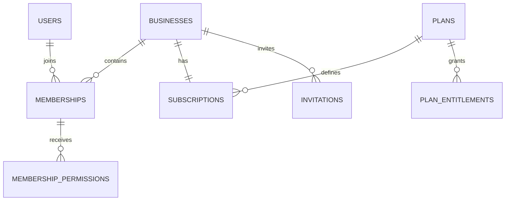
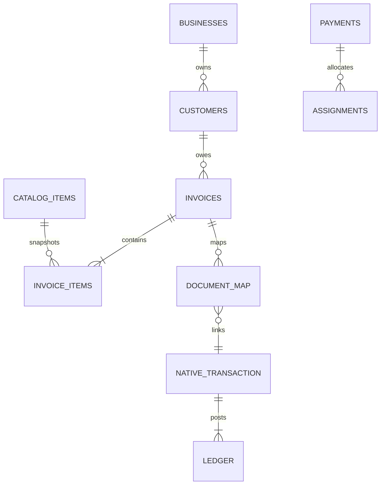
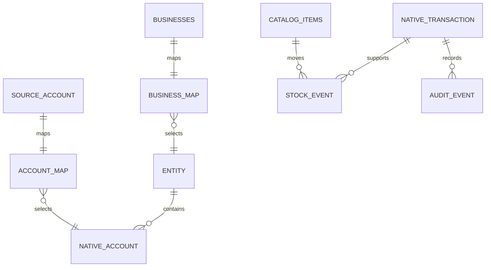

> Blueprint v1 · 11 October 2026 · Repository baseline `71ba8d08dc677f69e5bf0d18a3f00b6c6b22db65`. Source audit and proposed target design; no production activation is implied.

# Backend data model, schema and access control

## Provenance and canonical model

This is an implementation specification, not a live schema dump or executable production migration. Existing names come from tracked source/migrations. Existing repository notes report live metadata on 11 October 2026, but this documentation run did not query the deployed database. 0001_init.sql is additive and requires an untracked preexisting schema; docs/supabase_schema.sql uses conflicting names (business_members, sales/sale_items, price/quantity). Do not execute that legacy example as a baseline. First recover a schema-only authoritative snapshot and migration history; record version, grants, policies, triggers, enums and drift, excluding real data/secrets.

Retain public.businesses/memberships/catalog_items/customers/suppliers/invoices/payments/transactions. Retain native accounting private schema and UUID→integer mappings. For activated businesses, accounting.ledger is the single financial truth; public journals/financial_transactions are immutable historical evidence. Do not add a second independently mutable ledger, credit balance table or repayment total. Native assignment records are authoritative payment allocations, linked to public source UUIDs. Reuse existing notifications/payment_events/HR tables if actual baseline supports their semantics before adding equivalent tables.

## Relationship diagrams







Diagrams show logical relationships; polymorphic source-document links require runtime/trigger checks or type-specific FKs. They are not claims that every FK exists. Every tenant edge must carry business_id with ID; a globally unique UUID alone cannot enforce same-tenant parenthood.

## Dictionary conventions

For proposed public tenant tables, common columns T are: id uuid PK default gen_random_uuid(); business_id uuid NOT NULL FK businesses(id) ON DELETE RESTRICT; created_at timestamptz NOT NULL default now(); updated_at timestamptz NOT NULL default now(); version bigint NOT NULL default 1 CHECK >0; created_by uuid NOT NULL FK auth.users(id) with restricted deletion. Add UNIQUE(business_id,id) for composite children. These are target conventions; reconcile/backfill existing tables, not blind duplicate columns. Financial source timestamps include transaction_date/date, posted_at and created_at separately. Fields below are NOT NULL unless marked “nullable”. JSONB is bounded/schema-validated; never stores credentials or arbitrary executable prompts.

Common N for native tables: integer PK / library recyclable inheritance, business_id uuid NOT NULL, UNIQUE(id,business_id), tenant-aware composite FKs, forced RLS; timestamps follow native schema local-wall-time semantics, not automatic UTC conversion. Full exact DDL remains in 20261011090000_python_accounting_schema.sql and boundary migrations; use generator + pinned installed metadata for upgrades. Source NUMERIC target 19,2 and native 19,4 already used by tracked migrations; enforce API bounds and quantized NGN values, no unreviewed precision narrowing.

Table dictionaries below are target contracts. “Existing” means source references or tracked DDL, not independently verified deployed column set. Proposed extra fields/constraints on an existing table require drift reconciliation and reviewed migration.

### auth.users / profiles — DB-001

- **Provenance:** Existing identity.
- **Columns / types / nullability:** Auth-managed UUID identity; profiles id uuid PK/FK Auth, email text nullable, full_name text nullable, created_at/updated_at timestamptz.
- **Keys / constraints / lifecycle:** No Auth password in app tables; profiles self update, colleague projection only; retain actor reference via pseudonymized identity if lawful deletion required.
- **Relationships / index access:** Auth user → many memberships; no tenant_id on global identity.
- **Access:** Tenant member read only within permitted fields; operation-specific writer via authorized command, except global plan/Auth data which have their own read/admin boundary. No client financial DML or ledger delete.

### businesses — DB-002

- **Provenance:** Existing + target restrictions.
- **Columns / types / nullability:** id uuid PK; name text; business_type text CHECK PRODUCT/SERVICE/HYBRID; timezone text; status text active/restricted/deactivated; created_by uuid; contact fields nullable; version bigint.
- **Keys / constraints / lifecycle:** Mode/owner/status fields change only through authorized commands; IANA timezone validated; deletion RESTRICT after financial records.
- **Relationships / index access:** 1 business → many memberships/source records; 1 subscription/business.
- **Access:** Tenant member read only within permitted fields; operation-specific writer via authorized command, except global plan/Auth data which have their own read/admin boundary. No client financial DML or ledger delete.

### memberships — DB-005

- **Provenance:** Existing + permission version target.
- **Columns / types / nullability:** business_id uuid; user_id uuid FK Auth; role membership_role owner/admin/editor/viewer; permission_version bigint; state text active/revoked; joined_at timestamptz; PK(business_id,user_id).
- **Keys / constraints / lifecycle:** Existing role enum retained; active membership and grant ceiling checked; one active owner minimum via serialized command.
- **Relationships / index access:** Indexes (user_id,state,business_id) and (business_id,state,role).
- **Access:** Tenant member read only within permitted fields; operation-specific writer via authorized command, except global plan/Auth data which have their own read/admin boundary. No client financial DML or ledger delete.

### membership_permissions — DB-005

- **Provenance:** Proposed only if bundles insufficient.
- **Columns / types / nullability:** business_id uuid; user_id uuid; permission_code text; allowed boolean; PK(business_id,user_id,permission_code); composite FK memberships.
- **Keys / constraints / lifecycle:** Append audited changes; deny beats allow for revoked state; permission definitions versioned in code or catalogue.
- **Relationships / index access:** Membership → many overrides; avoid role/permission table proliferation initially.
- **Access:** Tenant member read only within permitted fields; operation-specific writer via authorized command, except global plan/Auth data which have their own read/admin boundary. No client financial DML or ledger delete.

### invitations — DB-005

- **Provenance:** Proposed.
- **Columns / types / nullability:** T; normalized_email text; role text; requested_permissions jsonb; token_digest text UNIQUE; expires_at timestamptz; state text pending/accepted/revoked/expired; accepted_user_id uuid nullable.
- **Keys / constraints / lifecycle:** Partial UNIQUE(business_id,normalized_email) WHERE pending; token single-use and expiry/seat lock; no plaintext invite token.
- **Relationships / index access:** Business → invitations; acceptance FK verified identity and membership.
- **Access:** Tenant member read only within permitted fields; operation-specific writer via authorized command, except global plan/Auth data which have their own read/admin boundary. No client financial DML or ledger delete.

### plans — DB-003

- **Provenance:** Proposed global config.
- **Columns / types / nullability:** code text BASE/GROW/TOP; version bigint; PK(code,version); display_name text; active boolean; price_minor bigint nullable; currency char(3) NGN.
- **Keys / constraints / lifecycle:** Published plan revisions are immutable; do not populate approved prices from prototype; immutable published revisions.
- **Relationships / index access:** Plan revision → many subscriptions/entitlements.
- **Access:** Tenant member read only within permitted fields; operation-specific writer via authorized command, except global plan/Auth data which have their own read/admin boundary. No client financial DML or ledger delete.

### plan_entitlements — DB-003

- **Provenance:** Proposed global config.
- **Columns / types / nullability:** plan_code text; plan_version bigint; feature_code text; enabled boolean; hard_limit bigint nullable; unit text nullable; PK(plan_code,plan_version,feature_code); FK plans revision.
- **Keys / constraints / lifecycle:** Limits >=0; no client updates; explicit business.hybrid false except TOP validated by deployment/test.
- **Relationships / index access:** Central config is sole policy source; public read limited to approved marketing fields.
- **Access:** Tenant member read only within permitted fields; operation-specific writer via authorized command, except global plan/Auth data which have their own read/admin boundary. No client financial DML or ledger delete.

### subscriptions — DB-003

- **Provenance:** Proposed private policy state.
- **Columns / types / nullability:** business_id uuid PK/FK; plan_code text; plan_version bigint; state text free/pending/active/grace/expired/cancelled; paid_through timestamptz nullable; grace_until timestamptz nullable; entitlement_version bigint; provider_customer_ref text nullable.
- **Keys / constraints / lifecycle:** One/business; owner-billing contact reference; provider event updates only; no direct authenticated DML.
- **Relationships / index access:** Indexes provider refs as needed; past revisions in subscription_events.
- **Access:** Tenant member read only within permitted fields; operation-specific writer via authorized command, except global plan/Auth data which have their own read/admin boundary. No client financial DML or ledger delete.

### subscription_events / billing_events — DB-003

- **Provenance:** Proposed; reuse payment_events if equivalent.
- **Columns / types / nullability:** id bigint identity PK; business_id uuid; provider text; provider_event_id text; payload_hash text; event_type text; received_at timestamptz; applied_at nullable; outcome text; UNIQUE(provider,provider_event_id).
- **Keys / constraints / lifecycle:** Store minimal signed evidence and provider refs; duplicate applied once; no unbounded raw card data.
- **Relationships / index access:** Business → events; event belongs to selected subscription and verified amount/currency.
- **Access:** Tenant member read only within permitted fields; operation-specific writer via authorized command, except global plan/Auth data which have their own read/admin boundary. No client financial DML or ledger delete.

### usage_counters — DB-003

- **Provenance:** Proposed.
- **Columns / types / nullability:** business_id uuid; metric text; period_start date; consumed bigint; reserved bigint; PK(business_id,metric,period_start).
- **Keys / constraints / lifecycle:** Counters >=0, atomic reserve/commit; UTC period; quota checked under lock; replay no double increment.
- **Relationships / index access:** Counters derived/reconcilable from immutable usage_events; no frontend writes.
- **Access:** Tenant member read only within permitted fields; operation-specific writer via authorized command, except global plan/Auth data which have their own read/admin boundary. No client financial DML or ledger delete.

### usage_events — DB-003

- **Provenance:** Proposed.
- **Columns / types / nullability:** id bigint identity PK; business_id uuid; metric text; operation_key uuid; units bigint; period_start date; occurred_at timestamptz; UNIQUE(business_id,metric,operation_key).
- **Keys / constraints / lifecycle:** Positive units except explicit refund event; audit provider-start versus pre-start cancellation; no billing arithmetic from UI.
- **Relationships / index access:** Index business/metric/period; tie usage to source/workflow result.
- **Access:** Tenant member read only within permitted fields; operation-specific writer via authorized command, except global plan/Auth data which have their own read/admin boundary. No client financial DML or ledger delete.

### catalog_items — DB-007

- **Provenance:** Existing + target safeguards.
- **Columns / types / nullability:** T; item_type text PRODUCT/SERVICE; SKU text nullable for service; name text; unit_price numeric(19,2); cost_price numeric(19,4); stock_quantity integer; reorder_level integer; duration integer; is_active boolean.
- **Keys / constraints / lifecycle:** Unique tenant SKU; nonnegative price/cost; SERVICE has no stock movements; stock_quantity derived/protected; archive referenced items.
- **Relationships / index access:** FK via business/id from sale/invoice/stock; indexed business,type,active,name,id.
- **Access:** Tenant member read only within permitted fields; operation-specific writer via authorized command, except global plan/Auth data which have their own read/admin boundary. No client financial DML or ledger delete.

### inventory_locations — DB-009

- **Provenance:** Proposed P2; one implicit location MVP.
- **Columns / types / nullability:** T; code text; name text; active boolean; UNIQUE(business_id,code).
- **Keys / constraints / lifecycle:** Do not add locations before multiple-site requirement; location-specific stock totals must reconcile to control.
- **Relationships / index access:** Location→many immutable movements.
- **Access:** Tenant member read only within permitted fields; operation-specific writer via authorized command, except global plan/Auth data which have their own read/admin boundary. No client financial DML or ledger delete.

### customers — DB-006

- **Provenance:** Existing + credit terms target.
- **Columns / types / nullability:** T; name text; normalized_phone text nullable; email text nullable; is_active boolean; credit_enabled boolean; credit_limit numeric(19,2) nullable; default_terms_days int nullable.
- **Keys / constraints / lifecycle:** Optional limit >=0; no mutable outstanding_balance truth; credit edits require permission and audit.
- **Relationships / index access:** 1 customer→many invoices/payments/follow-ups; duplicate contact warning not forced uniqueness.
- **Access:** Tenant member read only within permitted fields; operation-specific writer via authorized command, except global plan/Auth data which have their own read/admin boundary. No client financial DML or ledger delete.

### suppliers — DB-006

- **Provenance:** Existing.
- **Columns / types / nullability:** T; name text; phone/email/address text nullable; is_active boolean.
- **Keys / constraints / lifecycle:** Composite tenant parent keys; preserve referenced supplier; no cross-tenant bill.
- **Relationships / index access:** Supplier→purchases/native PAYABLE mapping.
- **Access:** Tenant member read only within permitted fields; operation-specific writer via authorized command, except global plan/Auth data which have their own read/admin boundary. No client financial DML or ledger delete.

### transactions / transaction_items — DB-010

- **Provenance:** Existing POS sources.
- **Columns / types / nullability:** Header T; customer_id uuid nullable; subtotal/tax/discount/total numeric(19,2); status text; payment_method text; entry_date date; posted_at timestamptz nullable. Lines T; transaction_id uuid; catalog_item_id uuid; description text; quantity integer; unit_price/line_total numeric(19,2); original_cost numeric(19,4).
- **Keys / constraints / lifecycle:** Composite tenant FKs; authoritative price snapshots; product cost fixed at fulfillment; service excludes COGS; posted source immutable.
- **Relationships / index access:** One header→many items; native document_map source_type pos; unique replay source.
- **Access:** Tenant member read only within permitted fields; operation-specific writer via authorized command, except global plan/Auth data which have their own read/admin boundary. No client financial DML or ledger delete.

### invoices / invoice_items — DB-011

- **Provenance:** Existing.
- **Columns / types / nullability:** Header T; customer_id uuid; invoice_number text; issue_date date; due_date date nullable; status text draft/sent/paid/overdue/void; subtotal/tax/total numeric(19,2). Lines T; invoice_id uuid; catalog_item_id uuid; description text; quantity integer; unit_price/line_total numeric(19,2).
- **Keys / constraints / lifecycle:** UNIQUE(business_id,invoice_number); due>=issue; issued snapshots immutable; partial paid is derived state/presentation until enum migration.
- **Relationships / index access:** Composite tenant FKs; one invoice→many items; paid/outstanding derived from native assignments.
- **Access:** Tenant member read only within permitted fields; operation-specific writer via authorized command, except global plan/Auth data which have their own read/admin boundary. No client financial DML or ledger delete.

### payments — DB-013

- **Provenance:** Existing + target treasury metadata.
- **Columns / types / nullability:** T; customer_id uuid nullable; invoice_id uuid nullable for multi-allocation extension; amount numeric(19,2); method text; treasury_account_id uuid; reference text nullable; transaction_date date; status text pending/verified/posted/reversed; provider_ref text nullable.
- **Keys / constraints / lifecycle:** amount>0; selected account ownership; gateway verified before ledger post; unique provider/ref where applicable; immutable posted receipt.
- **Relationships / index access:** 1 payment→many native assignments via mapped native transaction; no parallel mutable allocations table.
- **Access:** Tenant member read only within permitted fields; operation-specific writer via authorized command, except global plan/Auth data which have their own read/admin boundary. No client financial DML or ledger delete.

### payment_methods — DB-010

- **Provenance:** Proposed configuration or versioned code seed.
- **Columns / types / nullability:** business_id uuid; code text Cash/Transfer/Card; enabled boolean; account_id uuid nullable; provider_ref text nullable; PK(business_id,code).
- **Keys / constraints / lifecycle:** Explicit cash/bank mapping; gateway not enabled without verification; codes not trusted from user payload.
- **Relationships / index access:** Configured methods→source payments; never stores raw payment card credentials.
- **Access:** Tenant member read only within permitted fields; operation-specific writer via authorized command, except global plan/Auth data which have their own read/admin boundary. No client financial DML or ledger delete.

### purchases / purchase_items — DB-009

- **Provenance:** Proposed; reuse reconciled source if available.
- **Columns / types / nullability:** Header T; supplier_id uuid; document_date/due_date date; total numeric(19,2); status text draft/issued/received/paid. Lines T; purchase_id uuid; item_id uuid; quantity int; unit_cost numeric(19,4); line_total numeric(19,2).
- **Keys / constraints / lifecycle:** Atomic receive+inventory+AP; no duplicate receiving; composite item/supplier ownership; source mapping to native bill.
- **Relationships / index access:** Purchase→lines; receipt movement uses stable source line; status derived where possible.
- **Access:** Tenant member read only within permitted fields; operation-specific writer via authorized command, except global plan/Auth data which have their own read/admin boundary. No client financial DML or ledger delete.

### expenses / supplier_bills — DB-016

- **Provenance:** Proposed source facade; native bill is accounting truth.
- **Columns / types / nullability:** T; supplier_id uuid nullable; expense_date date; due_date date nullable; account_id uuid; amount numeric(19,2); status text draft/posted/reversed; paid flag is derived; notes text bounded.
- **Keys / constraints / lifecycle:** Do not duplicate equivalent native/source bill model; paid expense versus unpaid bill explicit; capital account allowed only with correct mapping.
- **Relationships / index access:** Expense→document_map; payments allocate native bill; tax disabled pilot.
- **Access:** Tenant member read only within permitted fields; operation-specific writer via authorized command, except global plan/Auth data which have their own read/admin boundary. No client financial DML or ledger delete.

### service_deliveries / jobs — DB-008

- **Provenance:** Reuse existing jobs then extend.
- **Columns / types / nullability:** T; invoice_item_id uuid nullable; service_item_id uuid; customer_id uuid; status text scheduled/in_progress/completed/cancelled; scheduled_at/delivered_at timestamptz nullable; cost_source_id uuid nullable.
- **Keys / constraints / lifecycle:** Record version transitions and reason; service item type required; delivery/recognition initially at issue; no stock changes.
- **Relationships / index access:** 1 service invoice line→0..many deliveries if partial fulfillment added later.
- **Access:** Tenant member read only within permitted fields; operation-specific writer via authorized command, except global plan/Auth data which have their own read/admin boundary. No client financial DML or ledger delete.

### credit_followups — DB-014

- **Provenance:** Proposed.
- **Columns / types / nullability:** T; customer_id uuid; invoice_id uuid nullable; channel text; due_at timestamptz nullable; outcome text; consent_version bigint nullable; body text bounded.
- **Keys / constraints / lifecycle:** No inferred interest/lending; no financial balance storage; reminder delivery through outbox and approved recipient.
- **Relationships / index access:** Customer→many collection records; index business,customer,created_at.
- **Access:** Tenant member read only within permitted fields; operation-specific writer via authorized command, except global plan/Auth data which have their own read/admin boundary. No client financial DML or ledger delete.

### credit_notes / refunds — DB-015

- **Provenance:** Proposed source facade to native postings.
- **Columns / types / nullability:** T; original_source_type text; original_source_id uuid; customer_id uuid nullable; amount numeric(19,2); reason text; approved_by uuid; status text; return_lines jsonb validated or normalized line table for partial returns.
- **Keys / constraints / lifecycle:** Totals/quantities bounded by original minus prior corrections; refund requires verified treasury transaction; original cost, stock condition retained.
- **Relationships / index access:** Native document_map/assignment preserve financial linkage; no destructive edit.
- **Access:** Tenant member read only within permitted fields; operation-specific writer via authorized command, except global plan/Auth data which have their own read/admin boundary. No client financial DML or ledger delete.

### accounts / legacy journal_entries / journal_lines — DB-017

- **Provenance:** Existing historical public.
- **Columns / types / nullability:** accounts UUID PK/business_id/name/type/is_active; journal header UUID business/date/status; lines account_id/debit/credit numeric (verify actual scale).
- **Keys / constraints / lifecycle:** Activated businesses read-only legacy; no new parallel writer; source names/types recovered from actual schema-only baseline.
- **Relationships / index access:** Accounts map to native typed account; journals retained as reconciliation evidence.
- **Access:** Tenant member read only within permitted fields; operation-specific writer via authorized command, except global plan/Auth data which have their own read/admin boundary. No client financial DML or ledger delete.

### accounting.business_map / account_map / party_map — DB-017

- **Provenance:** Tracked existing DDL.
- **Columns / types / nullability:** business_map business_id UUID PK, entity_id int unique, timezone text, state staged/active/blocked, cutover_date nullable, evidence nullable, tax_policy disabled. account_map PK(business_id,account_id), library_id int, flow_section cash/operating/investing/financing/restricted, purpose text. party_map PK(business_id,party_type,party_id), library_id int.
- **Keys / constraints / lifecycle:** Account map UNIQUE(business_id,library_id); same-business native FK and source ownership checks; runtime read-only provisioning/maps; active requires signed reconciliation.
- **Relationships / index access:** Business→entity; source account/customer/supplier→native account.
- **Access:** Tenant member read only within permitted fields; operation-specific writer via authorized command, except global plan/Auth data which have their own read/admin boundary. No client financial DML or ledger delete.

### accounting.entity / currency / category / account / reporting_period — DB-017

- **Provenance:** Tracked native model.
- **Columns / types / nullability:** N; entity name/multi_currency/year_start/locale, currency_id and period nullable; currency name/code/entity; category name/type/entity; account name/code/type/currency/category nullable/entity; period year/count/status/entity.
- **Keys / constraints / lifecycle:** Inherited recyclable IDs and composite native relationships from migration; pilot NGN/non-multicurrency; explicit reviewed period creation; unique entity account/period numbering.
- **Relationships / index access:** Entity→currency/accounts/periods; exact native DDL is authoritative for enum spelling.
- **Access:** Tenant member read only within permitted fields; operation-specific writer via authorized command, except global plan/Auth data which have their own read/admin boundary. No client financial DML or ledger delete.

### accounting.transaction / line_item / ledger — DB-017

- **Provenance:** Tracked canonical financial model.
- **Columns / types / nullability:** N; transaction transaction_date local timestamp, transaction_type enum, account/currency/entity IDs, main_account_amount numeric(19,4), credited/compound; line_item amount/quantity numeric(19,4), account/transaction; ledger entry_type debit/credit, amount numeric(19,4), post/folio/transaction IDs, optional line_item/tax/hash.
- **Keys / constraints / lifecycle:** Deferred balance check at outer commit; positive leg amount; posted rows immutable except single hash initialization; preserve native inheritance/FKs.
- **Relationships / index access:** Transaction→many line items/ledger legs; no public Data API access.
- **Access:** Tenant member read only within permitted fields; operation-specific writer via authorized command, except global plan/Auth data which have their own read/admin boundary. No client financial DML or ledger delete.

### accounting.assignment — DB-013

- **Provenance:** Tracked native allocations.
- **Columns / types / nullability:** id serial PK; business_id UUID; transaction_id int nullable native field; assigned_id int; assigned_type/number text; amount numeric(19,4); assignment_date local timestamp; entity_id int.
- **Keys / constraints / lifecycle:** amount>0; business composite FKs; API requires posting payment transaction and validates allocated invoice/bill remaining; no arbitrary null payment use at runtime.
- **Relationships / index access:** Payment native transaction→many assignments; target invoice/bill→many assignments.
- **Access:** Tenant member read only within permitted fields; operation-specific writer via authorized command, except global plan/Auth data which have their own read/admin boundary. No client financial DML or ledger delete.

### accounting.document_map / posting_requests / workflow_request — DB-017

- **Provenance:** Tracked DDL.
- **Columns / types / nullability:** document_map PK(business_id,source_type,source_id), transaction_id int; posting/workflow requests PK(business_id,request_key), payload_hash text, result JSONB; posting_request actor/time.
- **Keys / constraints / lifecycle:** Replay hashes/result immutable; source UUID ownership checked by source-type command; unique operation result; runtime insert/read only.
- **Relationships / index access:** Each source maps to native transaction; multiple legitimate source types require explicit keys.
- **Access:** Tenant member read only within permitted fields; operation-specific writer via authorized command, except global plan/Auth data which have their own read/admin boundary. No client financial DML or ledger delete.

### accounting.stock_event / reversal_map / audit_event — DB-009

- **Provenance:** Tracked DDL.
- **Columns / types / nullability:** stock_event bigint ID, business/source/item, quantity integer !=0, unit_cost numeric(19,4)>=0, unique business/source/item; reversal_map PK business/original native ID, reversal ID unique; audit_event bigint ID/business/actor/key/event/details/time.
- **Keys / constraints / lifecycle:** Stock-event source-line extension needed for repeated/multiple same-SKU operations; immutable evidence; trigger/command checks tenant ownership; one simple reversal per original.
- **Relationships / index access:** Movement supports source cost/quantity; commercial correction separate from simple reversal.
- **Access:** Tenant member read only within permitted fields; operation-specific writer via authorized command, except global plan/Auth data which have their own read/admin boundary. No client financial DML or ledger delete.

### accounting.balance / tax / recyclable / recycled / user — DB-017

- **Provenance:** Tracked native dependencies.
- **Columns / types / nullability:** Native balance amount/date/type/account/period; tax rate/account nullable; recyclable inheritance timestamps/deleted state; recycled restore records; user unused library model.
- **Keys / constraints / lifecycle:** Balance writes disallowed runtime; no second opening ledger. Tax disabled pilot; native user is not Auth/membership; no new use of recycling to erase postings.
- **Relationships / index access:** Preserve required native schema compatibility; remove only after upstream dependency analysis.
- **Access:** Tenant member read only within permitted fields; operation-specific writer via authorized command, except global plan/Auth data which have their own read/admin boundary. No client financial DML or ledger delete.

### upload_records — DB-023

- **Provenance:** Tracked secure-upload DDL.
- **Columns / types / nullability:** UUID ID/business/purpose/resource/actor; original_name; state reserved/quarantined/approved/rejected/cleanup states; paths; mime/extension; size_bytes; sha256; lifecycle timestamps.
- **Keys / constraints / lifecycle:** Exact current migration authoritative; allowlist/png-jpeg and quota reservation; parent tenant ownership; private immutable approved object; failed cleanup retried.
- **Relationships / index access:** Resource→approved attachments; no unconditional object access.
- **Access:** Tenant member read only within permitted fields; operation-specific writer via authorized command, except global plan/Auth data which have their own read/admin boundary. No client financial DML or ledger delete.

### outbox / delivery_attempts — DB-024

- **Provenance:** Proposed.
- **Columns / types / nullability:** outbox bigint ID/business/event_key uuid/event_type/payload JSONB/state/pending_at; UNIQUE(business_id,event_key,event_type); attempt ID/outbox FK/provider reference/status/time.
- **Keys / constraints / lifecycle:** Inserted with transaction; worker claim lease and bounded retry; recipient/consent explicit; no guarantee of exactly-once remote delivery without provider support.
- **Relationships / index access:** One event→many attempts; dead-letter reviewed, audit retained.
- **Access:** Tenant member read only within permitted fields; operation-specific writer via authorized command, except global plan/Auth data which have their own read/admin boundary. No client financial DML or ledger delete.

### sync_operations — DB-020

- **Provenance:** Proposed only for nonfinancial sync; finance reuses request tables.
- **Columns / types / nullability:** business_id uuid; actor_id uuid; device_id uuid; op_id uuid; command_type text; base_version bigint nullable; payload_hash text; result/state; captured_at/received_at timestamptz; PK(business_id,device_id,op_id).
- **Keys / constraints / lifecycle:** Device is metadata not identity; server policies current; never duplicates finance replay truth; clean completed operations under approved retention.
- **Relationships / index access:** Local IndexedDB schema mirrors op envelope, not unrestricted database replication.
- **Access:** Tenant member read only within permitted fields; operation-specific writer via authorized command, except global plan/Auth data which have their own read/admin boundary. No client financial DML or ledger delete.

### ai_conversations / ai_usage / ai_tool_audit — DB-021

- **Provenance:** Proposed.
- **Columns / types / nullability:** conversation T/actor/title/retention_until; messages separately if needed bounded role/content/redacted source refs; usage ID/business/actor/provider/model/prompt_version/tokens/cost_minor/status/request key; tool audit ID/permission/argument_hash/result scope/time.
- **Keys / constraints / lifecycle:** No credentials/raw financial dumps; row+column permissions; one financial confirmation links normal command; purge prompts at approved expiry; usage survives privacy deletion minimally.
- **Relationships / index access:** AI request→typed facts references and usage reservation; no cross-business vector collection.
- **Access:** Tenant member read only within permitted fields; operation-specific writer via authorized command, except global plan/Auth data which have their own read/admin boundary. No client financial DML or ledger delete.

### notifications / preferences / logs — DB-024

- **Provenance:** Existing references; reconcile actual columns.
- **Columns / types / nullability:** notification T/user_id/title/body/type/read_at nullable; preferences business/user/channel/consent/version; logs event/provider/status/time.
- **Keys / constraints / lifecycle:** Only recipients/authorized admin see contents; outbox owns delivery; preference changes audited.
- **Relationships / index access:** Business event→notification; no success claim before provider result.
- **Access:** Tenant member read only within permitted fields; operation-specific writer via authorized command, except global plan/Auth data which have their own read/admin boundary. No client financial DML or ledger delete.

### employees / attendance / payroll_runs / payslips — DB-025

- **Provenance:** Existing references + P2 target.
- **Columns / types / nullability:** Employee T/name/contact/active; attendance employee FK/check_in/check_out/status; payroll business/period/version/approval; payslip employee/run/amount breakdown numeric.
- **Keys / constraints / lifecycle:** Verify actual payroll schema and statutory policy before rollout; salary access via restricted projections; employee not membership identity.
- **Relationships / index access:** Tenant composite employee edges; approved payroll maps to expense/payment source.
- **Access:** Tenant member read only within permitted fields; operation-specific writer via authorized command, except global plan/Auth data which have their own read/admin boundary. No client financial DML or ledger delete.

### audit_logs / settings / deletion_requests — DB-026

- **Provenance:** Reuse audit where equivalent; settings/deletion proposed.
- **Columns / types / nullability:** Audit actor/business/action/object/diff hash/time; settings business/key/value/version; deletion request business/requester/scope/state/retention decision/time.
- **Keys / constraints / lifecycle:** No mutable audit; exclude secrets/raw prompt/PII fields; version sensitive settings; deletion cannot cascade away financial evidence.
- **Relationships / index access:** Business→settings/audit; public profile deletion separate from retained financial actor ID.
- **Access:** Tenant member read only within permitted fields; operation-specific writer via authorized command, except global plan/Auth data which have their own read/admin boundary. No client financial DML or ledger delete.

## Accounting and customer-debt invariants

1. Exactly one canonical financial writer per active business. Reconcile/import legacy journals or approved opening balances with detailed AR/AP/stock evidence; retain originals. No activation automation is supplied by existing source; build and rehearse separately.
2. Debit legs equal credit legs per native transaction at outer commit; amount >0 and finite. Use DB checks/triggers plus Decimal validation. Native 4-decimal storage does not imply fractional kobo is permitted in final NGN report; policy quantization explicit.
3. Every source, account, party, SKU, invoice and allocation belongs to same business. Composite FKs where concrete parents exist; type-specific trigger/command ownership for polymorphic source mappings. Reject business_id reassignment of existing financial rows.
4. One source issue/payment/return/correction event posts once with stable key/hash/result. Source status, ledger, allocation, stock, usage and audit commit together. Stock-event keys must distinguish purchase/return/fulfillment source-line IDs where the current unique key is insufficient.
5. Customer debt and invoice outstanding are computed from issued source/native transactions minus valid native allocations/credit notes as-of date. Do not store an editable balance as financial truth. Optional cached summaries have rebuild/reconcile procedure and transactionally controlled updates.
6. ReportingPeriod and financial dates preserved. Created_at/posted_at UTC audit instants differ from business-local transaction dates; native local timestamps follow existing documented convention. Past period cannot be silently reopened by library session.
7. Posted invoice/receipt/transaction lines immutable. Corrections are audited reversing/credit documents referencing original. Returns restore original sold cost where sellable; refund/credit allocation reconciles cash/AR. Financial evidence retention is separate from ordinary personal-data deletion.
8. Cash-flow maps each account to reviewed purpose/section, including bank treasury, restricted cash, financing and noncash legs. Unknown maps fail, no plug. Tax/FX/card restrictions remain until reviewed implementation and tests.

## Representative migration and RLS patterns

Illustrative only: reconcile existing identity/enum/table names and create migration using discovered CLI workflow during implementation. Do not run these snippets on production. No schema changes are part of this documentation PR.

```sql
-- Proposed same-business reference; backfill/reconcile orphans before validating.
ALTER TABLE public.customers ADD CONSTRAINT customers_tenant_key
  UNIQUE (business_id,id);
ALTER TABLE public.invoices ADD CONSTRAINT invoice_customer_tenant
  FOREIGN KEY (business_id,customer_id)
  REFERENCES public.customers(business_id,id) ON DELETE RESTRICT
  NOT VALID;
-- After orphan report/remediation and isolated upgrade tests:
ALTER TABLE public.invoices VALIDATE CONSTRAINT invoice_customer_tenant;
```

Sensitive source read policy example, assuming memberships has a nonrecursive self-read policy and state column has been migrated:

```sql
ALTER TABLE public.invoices ENABLE ROW LEVEL SECURITY;
REVOKE ALL ON public.invoices FROM anon;
GRANT SELECT ON public.invoices TO authenticated;
REVOKE INSERT, UPDATE, DELETE ON public.invoices FROM authenticated;
CREATE POLICY invoice_member_read ON public.invoices
FOR SELECT TO authenticated
USING (EXISTS (
  SELECT 1 FROM public.memberships m
  WHERE m.business_id=invoices.business_id
    AND m.user_id=(SELECT auth.uid()) AND m.state='active'
));
-- Add explicit permission predicate/projection if invoice reading is role-limited.
-- Member RLS alone does not protect salary/cost or privileged source writes.
```

Mode/plan enforcement: revoke direct client update of protected businesses columns, subscriptions, entitlement config and usage state; existing broad table UPDATE grants must also be removed because column revocation alone cannot narrow table-wide permission. Grant only whitelisted non-sensitive columns if still using direct edits. Apply mode via audited runtime command checking current subscription and membership under lock; DB trigger rejects Hybrid when effective TOP entitlement absent. Subscription change to restricted state does not delete current Hybrid mode/history. Eligibility guards cover product/service creation and mixed sale lines, not only the mode field.

Private native ledger pattern already present in repository, extended with granular permission checks:

```sql
ALTER TABLE accounting.ledger ENABLE ROW LEVEL SECURITY;
ALTER TABLE accounting.ledger FORCE ROW LEVEL SECURITY;
REVOKE ALL ON accounting.ledger FROM anon, authenticated;
-- Existing restricted role must be non-owner, non-superuser, NOBYPASSRLS.
GRANT SELECT, INSERT ON accounting.ledger TO cacu_runtime;
CREATE POLICY ledger_read_target ON accounting.ledger
FOR SELECT TO cacu_runtime
USING (accounting.authorized(business_id));
CREATE POLICY ledger_insert_target ON accounting.ledger
FOR INSERT TO cacu_runtime
WITH CHECK (accounting.authorized_writer(business_id));
-- Avoid duplicate permissive policies: inspect/drop superseded rules in reviewed migration.
-- Extend authorized_writer with operation-specific permission before introducing cashier roles.
```

Private helpers must use transaction-local verified actor/tenant, not editable JWT user_metadata. SECURITY INVOKER preferred. Existing accounting.lock_membership is a narrow SECURITY DEFINER exception with fixed search_path, actor/scope checks and revoked PUBLIC execute; preserve/test that justification. Audit all public privileged functions, grants and default privileges. Any report view exposed on Postgres >=15 uses security_invoker=true plus table policies, or revoke API access/private schema. UPDATE source policies need both USING and WITH CHECK with same-tenant ownership. Test Data API directly; an API guard does not secure bypass routes [technical R5/R7/R10].

## Indexing, migration and access patterns

Recommended target indexes (verify duplicates/query plans): memberships(user_id,state,business_id); invoices(business_id,customer_id,issue_date,id), partial issued/unpaid due-date index; payments(business_id,customer_id,transaction_date,id); catalog(business_id,item_type,is_active,name,id), tenant SKU uniqueness; native ledger(business_id,transaction_date,id) and (business_id,post_account_id,transaction_date); assignment(business_id,assigned_id,assignment_date); unique request/event keys; outbox(state,pending_at,id); AI usage(business_id,created_at); audit(business_id,created_at,id). Trigram search extension/index is a recommendation subject to measured query need, not verified by InventoryService's comment.

Use EXPLAIN ANALYZE on anonymized production-like data, cursor pagination and bounded reports. RLS predicates/membership indexes must be benchmarked too. Aggregates/AI retrieve predefined authorized facts, not arbitrary model SQL. Report snapshots expose ledger cutoff and reconciliation; accounting replicas/cache never authorize posting or credit limits. Cross-tenant caches forbidden; role-sensitive cache keys include actor/permission version and subscription/mode version.

Migration stages: schema-only baseline → disposable fresh install → representative upgrade with legacy history → orphan/drift report → validated composite constraints → restricted-role/grant/RLS tests → staged native mapping/import → signed reconciliation → preview end-to-end → explicit tenant activation. Migration role distinct from runtime/storage service key. Avoid blind IF NOT EXISTS hiding conflicting schema. Rollback uses compatible forward correction for financial data; do not drop columns/schema/history after writes. Backups include approved objects and DB; restore to isolated environment and compare financial control totals.

## Retention and deletion

Archive operational catalogue/parties while referenced. Revoke membership/invite without deleting actor evidence. Financial records and audit retained according to approved jurisdiction policy, currently unresolved; no automatic CASCADE tenant deletion. Approved upload retention tracks parent/source lifecycle. AI raw messages proposed 30 days, minimal usage/audit longer only with approved purpose; redacted per-role exports. Browser drafts/cache are not server-backed until committed; purge shared-device data at sign-out with unsynced-draft review. Periodic consistency jobs detect orphan mappings, stale pending files, mismatched counters and ledger/source differences; they report/block, never silently repair with invented entries.

## Data requirement register

| ID | Invariant and relevant model |
|---|---|
| DB-001 | PRD-001: email, password, verified identity, session; enforce workflow rules, ownership and `AT-001`. |
| DB-002 | PRD-002: business name, mode, timezone, membership; enforce workflow rules, ownership and `AT-002`. |
| DB-003 | PRD-003: plan version, subscription status, limits, usage, provider event; enforce workflow rules, ownership and `AT-003`. |
| DB-004 | PRD-004: current mode, requested mode, entitlement, impact report; enforce workflow rules, ownership and `AT-004`. |
| DB-005 | PRD-005: normalized email, role, permission set, expiry, token digest; enforce workflow rules, ownership and `AT-005`. |
| DB-006 | PRD-006: name, phone, optional email, terms, active flag; enforce workflow rules, ownership and `AT-006`. |
| DB-007 | PRD-007: SKU, name, price, cost mapping, unit, reorder threshold; enforce workflow rules, ownership and `AT-007`. |
| DB-008 | PRD-008: service name, price, duration, delivery record, direct costs; enforce workflow rules, ownership and `AT-008`. |
| DB-009 | PRD-009: SKU, quantity, location, unit cost, supplier, source document; enforce workflow rules, ownership and `AT-009`. |
| DB-010 | PRD-010: lines, customer for credit, authoritative prices, payment split, request key; enforce workflow rules, ownership and `AT-010`. |
| DB-011 | PRD-011: number, issue/due dates, party, snapshots, status, source mapping; enforce workflow rules, ownership and `AT-011`. |
| DB-012 | PRD-012: customer, credit limit, eligible flag, due date, cash portion, AR account; enforce workflow rules, ownership and `AT-012`. |
| DB-013 | PRD-013: customer, amount, cash/bank account, invoice allocation list, reference, request key; enforce workflow rules, ownership and `AT-013`. |
| DB-014 | PRD-014: as-of date, issued invoices, allocations, due dates, contact preference; enforce workflow rules, ownership and `AT-014`. |
| DB-015 | PRD-015: original document, quantities, reason, refund account, approval; enforce workflow rules, ownership and `AT-015`. |
| DB-016 | PRD-016: supplier, category/account, amount, paid/unpaid, document date, due date; enforce workflow rules, ownership and `AT-016`. |
| DB-017 | PRD-017: accounts, entity mappings, period, posting commands, opening evidence; enforce workflow rules, ownership and `AT-017`. |
| DB-018 | PRD-018: period, posted ledger, mappings, cash policy; enforce workflow rules, ownership and `AT-018`. |
| DB-019 | PRD-019: period totals, low stock, delivery records, aged debt; enforce workflow rules, ownership and `AT-019`. |
| DB-020 | PRD-020: device/op IDs, tenant/user namespace, local drafts, version, request key; enforce workflow rules, ownership and `AT-020`. |
| DB-021 | PRD-021: question, typed authorized aggregates, source/time metadata, usage reservation; enforce workflow rules, ownership and `AT-021`. |
| DB-022 | PRD-022: user text, allowlisted draft schema, catalog candidates, confirmation token; enforce workflow rules, ownership and `AT-022`. |
| DB-023 | PRD-023: file purpose, resource UUID, MIME, bytes, approved metadata; enforce workflow rules, ownership and `AT-023`. |
| DB-024 | PRD-024: event, recipient consent, export job, provider configuration; enforce workflow rules, ownership and `AT-024`. |
| DB-025 | PRD-025: employee, attendance, payroll inputs and policy version; enforce workflow rules, ownership and `AT-025`. |
| DB-026 | PRD-026: retention category, export/delete request, backup evidence, audit events; enforce workflow rules, ownership and `AT-026`. |
