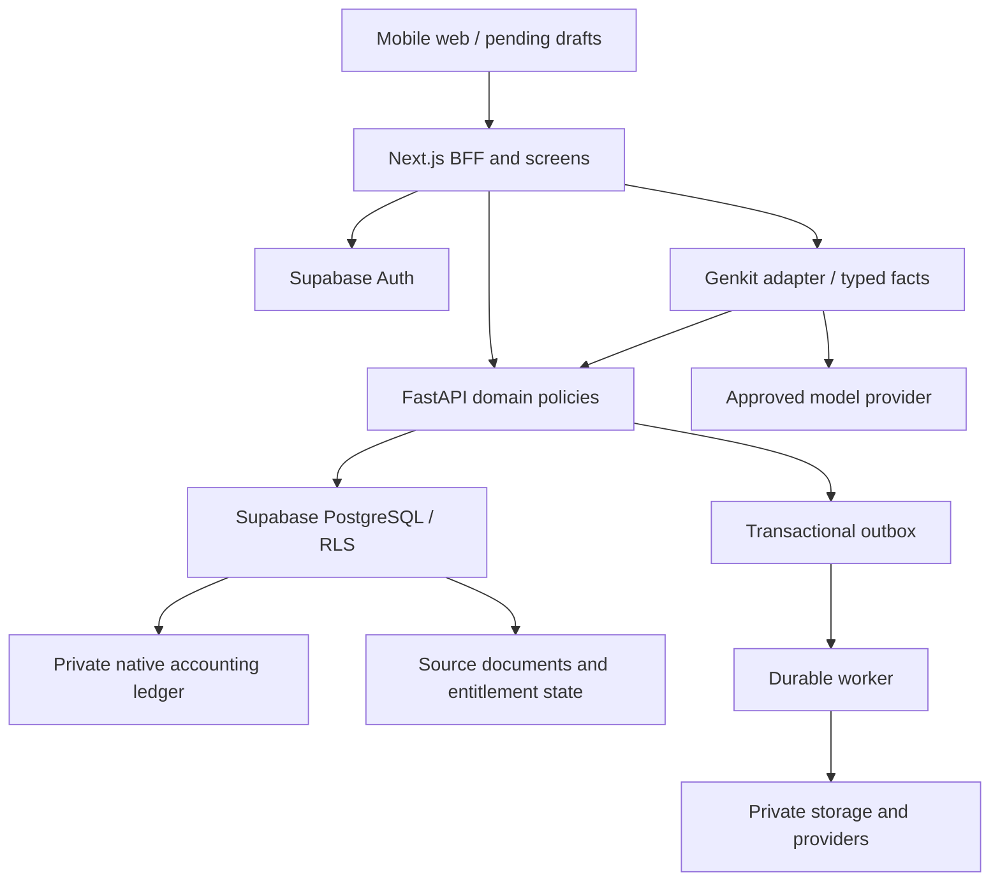

> Blueprint v1 · 11 October 2026 · Repository baseline `71ba8d08dc677f69e5bf0d18a3f00b6c6b22db65`. Source audit and proposed target design; no production activation is implied.

# Technical requirements and architecture

## Audit scope and confidence

Audited pinned GitHub main snapshot, not a running deployment. Retrieved 205 source/config/document files covering all non-UI application domains, backend and tests; inspected shared UI references and inventory. No AGENTS.md exists in the recursive tree. Binary assets and complete lockfile resolution were not executed. Dependency versions below are declared versions; installability, advisories, deployment and production RLS were not independently tested in this documentation run. Existing test files were inspected; previous verification results are attributed to repository documents, not rerun claims.

Current stack: Next.js 15.5.26, React/React DOM 19.2.1, TypeScript ^5, Tailwind ^3.4.1, Radix components, Supabase JS ^2.48.1 and SSR ^0.5.2. Backend pyproject declares Python >=3.12,<3.13, FastAPI 0.143.0, Pydantic 2.11.4, python-accounting 1.0.1, SQLAlchemy 2.1.4, psycopg 3.2.9 and Pillow 12.3.0. AI uses Genkit 1.42.0, Google plugin 1.28.0, configured googleai/gemini-1.5-flash; current provider availability/compatibility must be tested rather than inferred.

| Capability / status | Source evidence | Implication / smallest safe action |
|---|---|---|
| Auth: partially implemented; source verified | src/lib/supabase/client.ts, server.ts; src/middleware.ts; backend/cacu/auth/session.py | Preserve Auth; test real token expiry/revocation and deployed redirects |
| Tenant context: partially implemented | src/services/base-service.ts; business-provider.tsx; business-actions.ts | Current membership + explicit active-business selection; add stale-cache and offboarding tests |
| Modes: partial/inconsistent | setup/page.tsx defaults HYBRID; business-service.ts accepts PRODUCT/SERVICE/HYBRID | Replace unchecked mode changes with entitled command and DB guard |
| Subscription: defective for production enforcement | subscription-guard.tsx reads localStorage; billing/page.tsx simulates Paystack success with timers | Implement subscription/event/entitlement backend; remove simulated authority |
| Staff: prototype | settings/users/page.tsx uses initialUsers and local React changes | Wire invitations and current membership permissions; remove fabricated staff |
| Catalogue and parties: partial | catalog/actions.ts; customer-service.ts; inventory-service.ts | Keep reusable lists/forms; verify RLS and replace direct stock overwrite |
| POS/invoices/repayments: partial with staged Python path | sales-service.ts, invoice-service.ts, payment-service.ts; accounting/workflows.py | Preserve staged cutover; add customer credit/split payment/allocation contracts |
| Canonical double-entry: staged implementation | accounting/posting.py, session.py; accounting schema/boundary/cutover migrations | Atomic outer transaction, private native ledger and mappings; never assume production activation |
| Cash flow: staged implementation | accounting/reports.py; accounting/cash-flow page; cash-flow tests | Existing indirect adapter with traceable mappings; keep reconciliation and unsupported-policy flags |
| Credit page: different product prototype | credit/page.tsx contains preQualifiedOffers/lenders/applications | Do not treat lending offers as customer debt; add customer receivables screens separately |
| AI: partial/generic | ai/genkit.ts; business-insights-flow.ts; ai-assistant.tsx | Context/page text is not authorized financial retrieval; add identity/permission/quota and facts adapter |
| Offline: planned, no operational sync found | settings/offline/page.tsx uses fixed storage value and toast; no service worker/IndexedDB sync in tracked source | Introduce local pending drafts and recoverable sync; remove misleading success |
| Secure upload: staged implementation | uploads validation/service/worker/routes; secure upload migration; file-attachments.tsx | Private quarantine/approved flow and image decoding exist; deployed bucket grants/workers remain unverified |
| HR/storefront/apps/analytics: mixed prototype/partial | HR services/actions plus many local-state pages; src/lib/data.ts | Inventory individual screens; disable unsupported actions before pilot |
| Deployment: configuration present, hosted verification missing | backend/vercel.json, pyproject; docs/python-deployment.md; apphosting.yaml | Next root + separate backend project; Firebase hosting artifact remains; confirm owning projects |
| CI: configured, not run here | .github/workflows/ci.yml | Node 22 + Python 3.12, frozen uv, PG17 service, Jest/Chromium/build; inspect actual run result |
| Fresh schema: missing standalone baseline | 0001_init.sql depends on preexisting businesses/memberships/helpers; docs/supabase_schema.sql uses different names | Recover authoritative schema-only baseline, create fresh-install/upgrade tests before any release |
| Dependency/obsolete files: investigation needed | package-lock.json, uv.lock, src/package.json, cls, firestore.rules, apphosting.yaml | Inventory reachability and targeted advisory scan; do not bulk delete or run broad audit fix |

No feature is labeled end-to-end implemented-and-verified from file existence. Repository docs/python-accounting-cash-flow.md reports disposable PostgreSQL and browser component tests; those replace bearer verification and Server Actions respectively. They are useful prior evidence, not deployed Auth/full-stack proof. Earlier implementation-checkpoint.md and schema-reconciliation.md contain historical failures. Newer python-deployment.md documents uv exclusions for unused native drivers, while python-accounting-cash-flow.md still describes the older driver blocker. Treat frozen uv + hosted preview testing as the current deployment gate, and reconcile stale notes during implementation.

Specific source defects: legacy 0001_init.sql SECURITY DEFINER RPCs lack fixed search_path/explicit execute restrictions, and old sale/payment logic trusts client totals/omits some tenant locks. Cutover guards protect activated tenants, not every legacy tenant; live grants need inspection. Transfer receipt/POS in accounting/workflows.py currently maps Cash and Transfer to purpose('cash'), so a separate bank purpose/selected payment account is required. Native sale command has no customer/split-credit fields. Invoice price is required to equal catalog, so negotiated pricing needs an explicit authorized override. Unbounded invoices/balances and ledger_rows reporting scans need pagination/report limits. library_transaction obtains a per-business lock even for reads; benchmark and narrow read locking before scaling. ReportService's week interval is daily grouping and detailed P&L categories are empty: do not call those advanced reports complete.

## Current and target architecture

Current: App Router pages → Supabase cookie-backed services and legacy RPCs; selected financial operations → authenticated Next adapter → FastAPI → restricted SQLAlchemy/psycopg → private python-accounting schema. Supabase Auth supplies identities. Native library tables coexist with historical public UUID journals. Operational data stays public under RLS; financial writes route according to explicit business cutover state. Genkit currently executes from Next server code.

Target retains these technologies and a modular monolith. General operational domains migrate incrementally to the same policy boundary; no big-bang rewrite. One authoritative entitlement store serves Python policy decisions and Next UI snapshots. Next services may continue safe operational Supabase reads while Data API writes to protected state are denied or narrowly checked by database functions/triggers.



| Decision | Rationale and trade-off | Alternative / change trigger | Effort estimate |
|---|---|---|---|
| Keep Next + FastAPI + Supabase | Existing work and accounting boundary reusable; two deployments add a network hop | Consolidate projects only after deployment routing/observability proves benefit | 3–5 engineer-days foundation |
| Native private python-accounting ledger for activated tenants | Existing transactional safeguards and reports; upstream commits/model schema need pinned regression tests | Custom ledger only if measured library limitations justify migration and parity suite | 8–15 days cutover validation, excluding historic cleanup |
| NGN and explicit tax-free pilot | Existing adapter scope; avoids inaccurate FX/tax reports | Tax/FX support needs policies, mappings and reviewed fixtures before enabling | Tax/FX separately estimated after discovery |
| Central permissions + entitlements | Browser tampering cannot grant access; adds DB checks per operation | Short-lived versioned cache only with revocation/invalidation tests | 6–10 days |
| Vercel separate FastAPI project first | Official FastAPI support and current backend config; request-bound/stateless constraints | Managed container/worker for system dependencies, sustained tasks, cost/latency evidence | 2–4 days preview assessment |
| Outbox + one durable worker | Notifications/exports survive failures; no premature event platform | Add queue service when backlog/throughput requires it | 4–7 days |
| IndexedDB pending drafts | Structured local transactions; browser persistence can be evicted | Native app storage when device/UX evidence justifies it | 8–12 days |
| Retain Genkit behind adapter | Existing structured schema prompts; avoid second orchestration framework | New provider/plugin only after evaluations/cost/security tests | 5–8 days insights |

Estimates are planning ranges for an experienced engineer, not budget quotations. Hosting cost depends on traffic, connections, storage, token use and paid recovery options; meter them during pilot, rather than claiming free or fixed-price operation.

## Policy and API requirements

All endpoints proposed below use /api/v1/businesses/{business_id}; actor derives from verified bearer identity, not body. Never authorize from editable user_metadata. Next session access is only token transport after verification; API independently verifies. Current membership is checked in the DB each sensitive operation. Versioned policy evaluates membership permission, mode, entitlement, lifecycle, quota and source ownership; readers never gain mutation through uploads/AI/exports.

TECH-001/002/005: Auth/session, business selection and staff revoke share one contract. Granting permissions cannot exceed the grantor's ceiling; ownership transfer requires recent verification and atomic last-owner invariant. Bound invitation token to normalized verified email, tenant, role and expiry; store hash only.

TECH-003/004: plan codes never checked through string ranks in components. Resolve effective entitlements from versioned plan records; lock subscription/quota during protected writes. A policy failure cannot fall back to legacy financial functions. Mode changes and billing are server commands with DB state guards against direct PATCH/RPC bypass. Record entitlement version used by each operation.

| Existing route | Status / preserve |
|---|---|
| GET /health | Process-only check, not DB readiness |
| POST /v1/businesses/{id}/journals/validate | Existing older prefix; deprecate after callers migrate, no silent removal |
| POST /api/v1/businesses/{id}/invoices, /sales, /receipts, /postings, /journals | Existing staged financial commands; extend compatibly |
| GET /api/v1/businesses/{id}/invoices/balances | Exists; bound/paginate before volume growth |
| GET /api/v1/businesses/{id}/reports/summary, /reports/cash-flow | Exists; retain decimal strings and reconciliation metadata |
| POST/GET/DELETE file routes | Preserve current parent/purpose authorization and private delivery |

| Proposed contract | Request / response | Policy and invariant |
|---|---|---|
| GET /entitlements | version, plan code, effective mode, permissions, limits, usage, expiry/restricted reason | Tenant read; immutable server snapshot |
| POST /mode-changes/preview then /apply | requested_mode, preview version, request key → effect/restrictions | Owner + TOP for Hybrid, preserved history |
| POST /invitations; POST /invitations/{id}/accept; DELETE /memberships/{id} | email, permission bundle → pending/accepted/revoked | Staff admin, seat lock, last owner guard |
| GET/POST /catalog; PATCH /catalog/{id} | type, price string, unit, version → canonical item | Appropriate mode and permission; no direct stock quantity |
| GET/POST /customers and /suppliers | validated party fields/version → identity | Directory permission, tenant FK |
| POST /purchases; POST /inventory/adjustments | lines, cost, source, reason/request key → posting | Inventory/accounting permissions; quantity/cost atomic |
| POST /services/deliveries | invoice line, status, delivered_at → record | Service/Hybrid and delivery permission |
| POST /sales extended | lines, customer, quote_version, cash/bank splits, credit due date → sale/posting/outstanding | Sale + credit permission; exposure lock |
| POST /receipts extended | customer, allocation list, account, amount, request key → receipt/outstanding | Payments permission; no duplicate revenue |
| GET /receivables/ageing; GET /customers/{id}/statement | as_of, cursor → bucket rows / balance and events | Debt read, bounded and historically reproducible |
| POST /credit-notes; POST /refunds; POST /reversals | original, bounded lines/amount, reason, approval → correction | Manager/accountant with period/stock safeguards |
| POST /expenses; POST /supplier-payments | paid/unpaid, account, supplier, dates → source/posting | Accounting permission |
| GET /reports/{type}; POST /exports | dates, format, scope → report or job | Report-specific permissions and allowed columns |
| POST /sync/operations; GET /operations/{request_key} | pending command/base version → accepted/conflict/rejected | Recheck all current policies, never local claims |
| POST /ai/insights; POST /ai/drafts; POST /ai/drafts/{id}/confirm | query / structured proposal → facts/explanation/draft | Quota, fact permissions, explicit confirm for writes |
| POST /billing/checkout; GET /billing/status | plan code → provider redirect/pending status | Billing permission; provider owns payment confirmation |
| POST /webhooks/billing or /webhooks/payments | signed provider event → ack | Provider signature, timestamp, dedup; no user session assumption |

All money input/output is a decimal string; date YYYY-MM-DD, event timestamps ISO-8601 UTC, business timezone IANA. Unknown body fields forbidden. Pagination default 50/max 100, opaque cursor scoped to tenant and sort, date ranges bounded. 401 invalid identity; 403 disallowed operation; 404 unavailable foreign resource without enumeration; 409 stale quote/idempotency/policy/period conflict; 422 validation; 429 quota/rate limit; 503 dependency unavailable. Target error envelope: {error:{code,message,field_errors,request_id,retryable}} with no tokens/SQL/PII. Existing detail errors require adapter compatibility until versioned migration.

TECH-010/012/013 example proposed split-credit command:

```json
{
  "request_key": "00000000-0000-4000-8000-000000000010",
  "customer_id": "00000000-0000-4000-8000-000000000020",
  "entry_date": "2026-10-11",
  "due_date": "2026-10-25",
  "quote_version": 7,
  "items": [{"catalog_item_id":"00000000-0000-4000-8000-000000000030","quantity":2}],
  "payments": [{"method":"Transfer","account_id":"00000000-0000-4000-8000-000000000040","amount":"40000.00"}],
  "credit_amount": "60000.00"
}
```

Server prices yield 100000.00, then returns sale/invoice IDs, posting ID, total 100000.00, received 40000.00, outstanding 60000.00, request key, policy version. Current SaleCreate does not accept this shape; add a versioned extension with migration tests.

## Financial transaction boundaries

TECH-009–018: maintain the existing external transaction session, not upstream per-pair commits. Monetary precision matches reconciled native metadata; source money numeric(19,2), cost numeric(19,4) proposal, Decimal arithmetic and explicit half-up rounding policy; no JS float as authoritative ledger value. Compare actual native numeric scales before changing them. Quantize each stored line; invoice total is sum of stored line/tax/discount values with explicit rounding line where needed, never a hidden difference.

```text
verify bearer identity
begin restricted transaction; set tenant and actor locally
lock current membership; assert operation permission
lock subscription and relevant quota row; assert mode/entitlement
look up committed request key; return original if identical, conflict if different
lock affected invoices, customer exposure and SKU rows in deterministic order
validate authoritative prices, amounts, due dates, source links and open period
post source, native ledger, stock, allocations, usage and audit together
insert outbox event and durable replay result
commit once; return committed result
```

Bound idempotency to business + operation key + normalized payload hash; store original result. Obtain existing replay after identity/membership checks, but do not demand a new unused quota unit. A revoked permission never exposes a forbidden replay. Provider event uses provider+event ID unique key and same financial idempotency boundary. Do not generate a new request key on timeout.

Credit exposure = sum issued unpaid invoices less allocated valid payments/credits, including opening receivables imported with evidence; drafts excluded. Partial cash sale: debit cash/bank 40000, debit customer AR 60000, credit revenue 100000, plus product debit COGS/credit inventory. Initial tax-free policy; later tax postings require mapped payable and approved fixture. Receipt debit selected cash/bank, credit AR. Customer advances credit liability until applied. Write-off debit bad-debt expense/credit AR only with approval; never invent interest or a lending decision.

Inventory target: weighted-average receiving, original-sale cost for sellable returns, no negative stock, service exclusions, quantity/cost ledger control reconciliation. Current locked cost_price policy is simpler; migrate with signed costing evidence and preserve historical cost, rather than relabeling it weighted-average. Invoice issue and stock fulfillment currently coincide; separate delivery/fulfillment only when implemented with unique source movements.

Cash-flow report uses existing native adapter, indirect sections and reconciled mappings, no gap plugs. Initial FX effect zero only under NGN-only policy. Missing account map/tax/gateway scope must reject or show restricted availability. Treasury account selection fixes current Transfer mapping. Current per-business advisory lock is conservative; partition locks by entity/sequence/customer/SKU only after contention tests prove correctness.

## Offline, AI, jobs and scaling

TECH-020: service worker caches static shell; authenticated response caches are not shared. IndexedDB namespaces user+business+device; local op_id, stable request key, base version, captured_at and explicit pending state. Never persist bearer/service credentials in draft records. Cached last-known permissions only control capture UX, never posting. Reconnect login → fetch policy → submit dependency-ordered commands → resolve price/stock/period/mode conflicts through review. Immutable financial events use command replay, not last-write-wins. Mutable catalogue/settings use optimistic row version. Local eviction/storage denial shows a warning and offers manual draft export with authorization; do not claim all browsers retain drafts. User must choose before discarding unsynced drafts on logout; shared-device default purges local financial caches.

TECH-021/022: retain Genkit, wrap provider selection/config and prompt version; verify available model IDs and plugin compatibility in staging. Typed fact queries enforce tenant + role + mode + entitlement before retrieval, with limits, dates and metric provenance. Generic help has no tenant financial context. Tenant insights receive minimal aggregates; redact contact/bank details. Provider consent/retention controls are release gates; disable tenant context when unapproved. Structured output schema rejects unsupported fields/tools. Only allowlisted read tools; draft tool never commits. Confirm token binds payload hash/actor/tenant/expiry, then ordinary command revalidates. Prompt injection is untrusted text and cannot alter tool permissions. Reserve AI invocation plus token budget atomically; cap tokens, concurrent calls and daily currency spend. Quota reached → plain product help, never unmetered fallback. Evaluate hallucination, refusal on missing facts, prompt injection and cross-tenant requests before activation.

TECH-023/024: preserve upload quarantine/approved buckets and PNG/JPEG policy; extend quotas through entitlement snapshot later. No raw HTML/SVG/PDF uploaded execution. Authorized resource checks precede privileged storage work; secret storage key stays isolated server-side. Durable outbox records finance event at commit. Worker claims jobs with bounded retries/backoff and dead-letter inspection; payment posting is never best-effort background work. Notifications/exports/reminders may be jobs; idempotent external delivery needs provider key/reconciliation where available. Large exports use snapshot, bounded memory and private expiring object access.

TECH-019/026: query indexes begin with business_id and sort/filter columns. Limit lists; preaggregate bounded report ranges with signed reconciliation, never cross-tenant cache keys. Use Supavisor transaction pooling with transaction-local state and prepared statements disabled for current driver configuration; verify actual pooling mode/role support. NullPool avoids client connection proliferation; budget DB pool/concurrency separately from platform autoscaling. Do not introduce Redis/replicas until measured bottleneck.

Proposed scaling gates: begin 100 pilot tenants/50 RPS test; measure posting/read p95, lock wait, DB CPU/connections, report duration, job lag and cost per active business. >70% sustained DB connection budget or >2s p95 posting triggers bounded concurrency/query/lock analysis; >5s reports trigger indexed/precomputed views; >5min queue lag triggers workers; DB CPU >70% after optimization triggers larger instance/read replicas for non-authoritative reports. A 1000-tenant/500-RPS load stage follows only if budget and fixtures pass. Millions of registered users is a later capacity target, not a present concurrency claim.

## Security, operations and deployment gates

Enforce deny-by-default permissions at BFF/API and DB grants/RLS. Use column projection to protect salaries/costs/bank details; SELECT * plus row policies does not implement field permissions. Privileged financial functions in private schema, fixed search_path, revoked PUBLIC execute, explicit actor/membership checks. Direct Data API mode/subscription/source mutation must have equivalent guards. Audit support access, permission/mode/plan changes and adjustments. Apply origin/CSRF controls for cookie-backed actions; signed payment webhooks have separate verification. No broad service-role credential for ordinary finance calls.

Next public env contains only Supabase URL/publishable key. Server-only CACU_ACCOUNTING_API_URL, runtime CACU_DATABASE_URL, storage service key and model secrets are scoped per environment. TLS verify-full and trusted PG certificate. No production secrets in PR jobs. Native schema provisioning and activation use separate reviewed migration credentials. Rate limits target user/tenant/IP, with financial collection route allowances so sales quota does not block repayments. Structured correlation IDs propagate BFF→API→DB audit→outbox. Log sanitized codes/duration/counts, not financial request payloads.

Existing CI is the baseline: npm ci, lint/typecheck/Jest/Chromium/build; uv lock --check, frozen sync, pytest with disposable PG17. Add fresh-install and representative-upgrade/RLS tests plus true staging Auth→Next→FastAPI→Supabase flows. Pinned library updates require accounting regression, not ordinary dependency bumps. Scan advisories/reachability with exact locks; prior audit counts are historical, not current findings.

Deploy Next project rooted at repository root and Python rooted backend, matching current pyproject entrypoint. Official Vercel FastAPI support permits this shape [R1]. Confirm account/project ownership, paid commercial suitability, function limits, TLS/pool transport and cold-start/bundle performance in preview; no production domain switch in documentation work. A stateless function handles API requests; durable worker separately handles independent jobs. Switch backend to managed container only on measured sustained-job/native dependency/platform constraint. Preview uses isolated data and allowlisted callbacks. Migrations run as explicit release stage before activation, with schema-only drift report and restore rehearsal. Rollback application only if schema compatible; financial rollback uses reconciliation/reversal, never deletion or silently restoring legacy writers.

Backups must cover DB, private objects and configuration inventory. Proposed RPO/RTO in PRD-026 remain targets until timed restore. Test restored journal totals, AR/AP/inventory/cash and source links. Financial retention and tax/HR policy require current expert review; this blueprint makes no statutory compliance claim.

## Research register and applicability

Read 11 October 2026. Dates below are publication/update dates only where explicitly available; otherwise unspecified. Recommendations combine official guidance with repository-specific design judgment. No recommended version upgrade was installed here.

| Ref | Source, URL, date | Validated choice / boundary |
|---|---|---|
| R1 | [Vercel FastAPI](https://vercel.com/docs/frameworks/backend/fastapi), date unspecified | Native app entrypoint and separate backend deployment are supported; hosted CACU compatibility still requires preview |
| R2 | [Next.js Data Security](https://nextjs.org/docs/app/guides/data-security), date unspecified | Server-side data boundary, authorization and minimal DTOs; Server Actions treated as externally callable |
| R3 | [FastAPI Current User](https://fastapi.tiangolo.com/tutorial/security/get-current-user/), date unspecified | Dependency pattern for authenticated actor; CACU verifies Supabase rather than creating another identity service |
| R4 | [FastAPI Deployment Concepts](https://fastapi.tiangolo.com/deployment/concepts/), date unspecified | Replication, restart and process resource choices need deployment-specific design |
| R5 | [Supabase RLS](https://supabase.com/docs/guides/database/postgres/row-level-security), date unspecified | Grants and row policies both required; exposed tables secured and privileged keys kept server-side |
| R6 | [Supabase Connection Guidance](https://supabase.com/docs/guides/database/connecting-to-postgres), date unspecified | Choose direct/session/transaction connection against runtime needs; do not assume all pooling semantics equivalent |
| R7 | [PostgreSQL Row Security](https://www.postgresql.org/docs/current/ddl-rowsecurity.html), v18 current docs | Owners/BYPASSRLS matter; runtime ownership restrictions and forced RLS are deliberate |
| R8 | [PostgreSQL Numeric Types](https://www.postgresql.org/docs/current/datatype-numeric.html), v18 current docs | Exact numeric storage for money; explicit precision and rounding policy |
| R9 | [PostgreSQL Transaction Isolation](https://www.postgresql.org/docs/current/transaction-iso.html), v18 current docs | Concurrent reads do not substitute for locks/invariants; test conflict/retry paths |
| R10 | [OWASP Authorization](https://cheatsheetseries.owasp.org/cheatsheets/Authorization_Cheat_Sheet.html), date unspecified | Deny by default, least privilege and request-level resource authorization |
| R11 | [OWASP LLM Prompt Injection Prevention](https://cheatsheetseries.owasp.org/cheatsheets/LLM_Prompt_Injection_Prevention_Cheat_Sheet.html), date unspecified | Input isolation and constrained tools; prompt wording alone is insufficient |
| R12 | [OWASP File Upload](https://cheatsheetseries.owasp.org/cheatsheets/File_Upload_Cheat_Sheet.html), date unspecified | Allowlist/content validation, generated names, private storage and bounded files |
| R13 | [MDN IndexedDB](https://developer.mozilla.org/en-US/docs/Web/API/IndexedDB_API), date unspecified | Structured transactional local persistence; durable business success still server-confirmed |
| R14 | [python-accounting docs](https://python-accounting.readthedocs.io/en/latest/), docs heading 0.1.0 | Native accounting/report semantics; docs version differs from repo 1.0.1, verify installed source signatures |
| R15 | [Genkit models](https://genkit.dev/docs/js/models/), date unspecified | Model/provider configuration abstraction can preserve current framework |
| R16 | [WCAG 2.2](https://www.w3.org/TR/WCAG22/), Recommendation | Accessibility target; implementation needs measured audit |
| R17 | [Supabase SSR client](https://supabase.com/docs/guides/auth/server-side/creating-a-client?queryGroups=framework&framework=nextjs), date unspecified | Cookie refresh and verified identity; Next 15 uses middleware.ts, not Next 16 proxy.ts |
| R18 | [Supabase changelog](https://supabase.com/changelog), entries through 8 October 2026 | Review platform changes before implementation; no new infrastructure inferred from alpha announcements |
| R19 | [Postgres 15.19/17.11 security upgrade notice](https://supabase.com/changelog/postgres-15-19-17-11-breaking-changes), 25 September 2026 | Check deployed server/affected extensions and review required maintenance; no live DB version asserted |

The changelog markdown endpoint returned unsupported content type in research; HTML changelog and linked relevant database notice were read instead. SSR package changelog shows newer releases than ^0.5.2; compatibility/security upgrade is a separate tested task. Current repo uses TypeScript ^5, consistent with announced future minimum; do not upgrade frameworks from latest examples blindly.

## Technical requirement mapping

| ID | Implementation contract |
|---|---|
| TECH-001 | Enforce PRD-001 workflow/rules and `AT-001` at authenticated API plus DB invariants; corresponding schema DB-001, screen FLOW-001, task IMP-001. |
| TECH-002 | Enforce PRD-002 workflow/rules and `AT-002` at authenticated API plus DB invariants; corresponding schema DB-002, screen FLOW-002, task IMP-002. |
| TECH-003 | Enforce PRD-003 workflow/rules and `AT-003` at authenticated API plus DB invariants; corresponding schema DB-003, screen FLOW-003, task IMP-003. |
| TECH-004 | Enforce PRD-004 workflow/rules and `AT-004` at authenticated API plus DB invariants; corresponding schema DB-004, screen FLOW-004, task IMP-004. |
| TECH-005 | Enforce PRD-005 workflow/rules and `AT-005` at authenticated API plus DB invariants; corresponding schema DB-005, screen FLOW-005, task IMP-005. |
| TECH-006 | Enforce PRD-006 workflow/rules and `AT-006` at authenticated API plus DB invariants; corresponding schema DB-006, screen FLOW-006, task IMP-006. |
| TECH-007 | Enforce PRD-007 workflow/rules and `AT-007` at authenticated API plus DB invariants; corresponding schema DB-007, screen FLOW-007, task IMP-007. |
| TECH-008 | Enforce PRD-008 workflow/rules and `AT-008` at authenticated API plus DB invariants; corresponding schema DB-008, screen FLOW-008, task IMP-008. |
| TECH-009 | Enforce PRD-009 workflow/rules and `AT-009` at authenticated API plus DB invariants; corresponding schema DB-009, screen FLOW-009, task IMP-009. |
| TECH-010 | Enforce PRD-010 workflow/rules and `AT-010` at authenticated API plus DB invariants; corresponding schema DB-010, screen FLOW-010, task IMP-010. |
| TECH-011 | Enforce PRD-011 workflow/rules and `AT-011` at authenticated API plus DB invariants; corresponding schema DB-011, screen FLOW-011, task IMP-011. |
| TECH-012 | Enforce PRD-012 workflow/rules and `AT-012` at authenticated API plus DB invariants; corresponding schema DB-012, screen FLOW-012, task IMP-012. |
| TECH-013 | Enforce PRD-013 workflow/rules and `AT-013` at authenticated API plus DB invariants; corresponding schema DB-013, screen FLOW-013, task IMP-013. |
| TECH-014 | Enforce PRD-014 workflow/rules and `AT-014` at authenticated API plus DB invariants; corresponding schema DB-014, screen FLOW-014, task IMP-014. |
| TECH-015 | Enforce PRD-015 workflow/rules and `AT-015` at authenticated API plus DB invariants; corresponding schema DB-015, screen FLOW-015, task IMP-015. |
| TECH-016 | Enforce PRD-016 workflow/rules and `AT-016` at authenticated API plus DB invariants; corresponding schema DB-016, screen FLOW-016, task IMP-016. |
| TECH-017 | Enforce PRD-017 workflow/rules and `AT-017` at authenticated API plus DB invariants; corresponding schema DB-017, screen FLOW-017, task IMP-017. |
| TECH-018 | Enforce PRD-018 workflow/rules and `AT-018` at authenticated API plus DB invariants; corresponding schema DB-018, screen FLOW-018, task IMP-018. |
| TECH-019 | Enforce PRD-019 workflow/rules and `AT-019` at authenticated API plus DB invariants; corresponding schema DB-019, screen FLOW-019, task IMP-019. |
| TECH-020 | Enforce PRD-020 workflow/rules and `AT-020` at authenticated API plus DB invariants; corresponding schema DB-020, screen FLOW-020, task IMP-020. |
| TECH-021 | Enforce PRD-021 workflow/rules and `AT-021` at authenticated API plus DB invariants; corresponding schema DB-021, screen FLOW-021, task IMP-021. |
| TECH-022 | Enforce PRD-022 workflow/rules and `AT-022` at authenticated API plus DB invariants; corresponding schema DB-022, screen FLOW-022, task IMP-022. |
| TECH-023 | Enforce PRD-023 workflow/rules and `AT-023` at authenticated API plus DB invariants; corresponding schema DB-023, screen FLOW-023, task IMP-023. |
| TECH-024 | Enforce PRD-024 workflow/rules and `AT-024` at authenticated API plus DB invariants; corresponding schema DB-024, screen FLOW-024, task IMP-024. |
| TECH-025 | Enforce PRD-025 workflow/rules and `AT-025` at authenticated API plus DB invariants; corresponding schema DB-025, screen FLOW-025, task IMP-025. |
| TECH-026 | Enforce PRD-026 workflow/rules and `AT-026` at authenticated API plus DB invariants; corresponding schema DB-026, screen FLOW-026, task IMP-026. |
